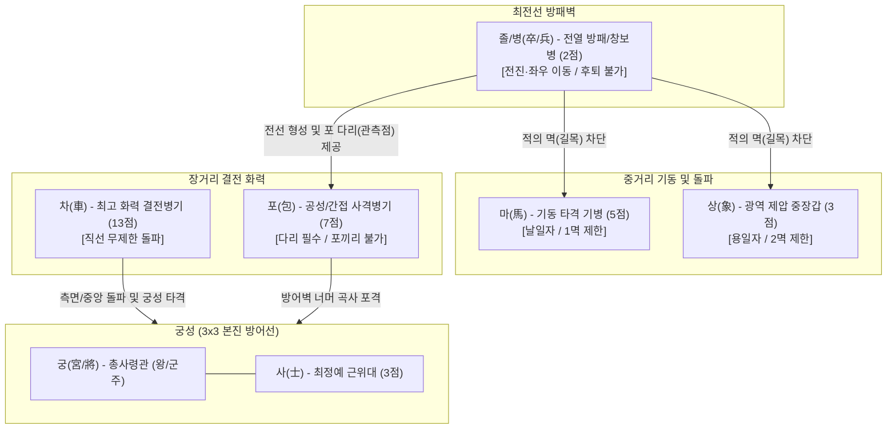
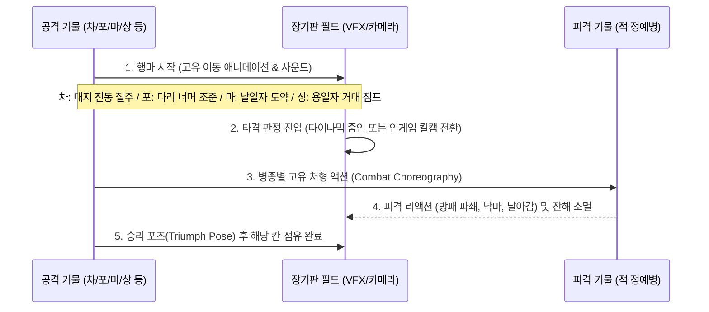

# 국가별 중세 정예병 스킨 기반 배틀체스(Battle Chess) 스타일 한국 장기(Janggi) 세계관 및 병종 매핑 리서치 보고서

> **문서 목적**: 한국 장기(Janggi)의 7대 기물이 가진 고유한 행마법(이동 규칙, 길목/멱 제한, 다리 조건, 궁성 제한 등)과 전술적 가치를 분석하고, 이를 동서양 중세 군사사의 실제 정예 병종(Elite Units)과 1:1로 매칭하여 **'배틀체스(Battle Chess) 스타일 중세 판타지/역사 전략 게임'**의 비주얼, 고증, 전투 애니메이션(Kill Cam & Choreography) 설계 기준을 수립한다.

---

## 1. 장기 7대 기물의 전술적 역학과 중세 병종 매핑 원리

장기는 서양 체스(Chess)와 달리 **'길목(멱)'**, **'다리(포대/중계물)'**, **'궁성(3×3 사령부)'**이라는 독특한 공간적·물리적 제약을 가진다. 이는 중세 전장의 실제 물리 법칙(돌격 가속 공간, 직사/곡사 화기의 사선 확보, 본진 진영 유지)과 놀라울 정도로 정확하게 대응된다.

### 1.1 기물별 행마 역학 및 중세 전술 매핑 상세

| 장기 기물 | 기물 점수 | 행마 규칙 및 제약 조건 | 중세 군사 전술적 해석 및 병종 매핑 원리 |
| :--- | :---: | :--- | :--- |
| **궁 (宮 / 將)** *(King / Commander)* | 무가치 (승패 결정) | • 궁성(3×3) 내부의 직선 및 대각선 길로 1칸씩만 이동 • 궁성 밖 이탈 절대 불가 • 빅장(왕끼리 마주보기) 규칙 적용 | **야전 총사령관 및 군주 (Monarch / Grand Master)** 중세 회전(Pitched Battle)에서 지휘관은 본진 언덕의 군막(Pavilion) 및 지휘 본부(궁성)를 벗어나지 않고 전황을 통제한다. 본진이 무너지면 전군이 패주하므로 궁성이라는 지휘 통제 구역 내부에만 머무른다. |
| **차 (車)** *(Chariot / Heavy Shock)* | **13점** | • 가로·세로 직선 방향으로 거리 제한 없이 이동 • 궁성 내부 대각선 이동 가능 • 경로상 첫 적 기물을 즉시 타격 | **초중장갑 결전 돌격대 / 중기병 랜스 차지 (Heavy Shock Lancer / War Wagon)** 장기판 최고의 파괴력을 지닌 결전 병기. 한 번 가속이 붙어 직선 돌파로가 열리면 전열을 일거에 분쇄하는 중세의 **풀 플레이트 랜스 차지(Lance Charge)**, **개마무사 중장돌격**, 또는 **후스파 전차(War Wagon)**에 해당한다. |
| **포 (包)** *(Cannon / Siege Engine)* | **7점** | • 직선 이동하되 반드시 **다른 기물 1개(다리/포대)**를 넘어야만 이동 및 공격 가능 • **포(包)끼리는 서로 넘을 수도, 잡을 수도 없음** | **곡사 공성 병기 및 중화기 (Trebuchet / Bombard / Hwacha)** 직사가 아닌 **곡사(Indirect Fire)** 또는 **전방 관측수/방패벽(다리) 엄호 사격**을 수행하는 병종. 앞에 엄폐물이나 관측 진영(다리)이 있어야 방열 및 사격이 가능하며, 공성 포병 진지끼리는 은폐·엄폐 및 사거리 특성상 서로를 직접 조준 타격하지 못한다는 규칙('포불장포')과 완벽히 부합한다. |
| **마 (馬)** *(Cavalry / Knight)* | **5점** | • 직선 1칸 전진 후 대각선 1칸 이동 (**날일자 日**) • 출발 지점 바로 앞(직선 1칸)에 기물이 있으면 **'멱'**이 막혀 이동 불가 | **기동 타격 기병 (Mounted Knight / Heavy Cavalry)** 군마가 최고 속도로 도약·선회하기 위해서는 **최소 1칸의 발진 가속 공간(멱)**이 필요하다. 바로 코앞에 보병 방패벽이나 장애물이 밀집해 있으면 군마가 돌진하지 못하고 정지하는 중세 기병의 물리적 한계를 '멱'으로 구현한다. |
| **상 (象)** *(War Elephant / Behemoth)* | **3점** | • 직선 1칸 전진 후 대각선 2칸 이동 (**용일자 用**) • 직선 1칸 및 대각선 첫 칸 중 **어느 한 곳이라도 막히면(2중 멱)** 이동 불가 | **전투 코끼리 / 초중량 공성 돌파수 (War Elephant / Halberdier Juggernaut)** 마(馬)보다 훨씬 거대한 덩치와 질량을 가진 중장갑 돌파 병종. 한번 탄력을 받으면 마보다 더 멀리(용일자) 적진을 짓밟으며 날아오르지만, 덩치가 크고 회전 반경이 넓어 **진로(2칸의 멱)에 작은 방해물만 있어도 기동이 봉쇄**되는 거대 병기의 특성을 대변한다. |
| **사 (士)** *(Royal Guard / Paladin)* | **3점** | • 궁성(3×3) 안에서만 직선 및 대각선 1칸 이동 • 왕(궁)의 좌우/전방을 밀착 마크하며 육탄 방어 | **군주 직속 최정예 근위대 (Royal Bodyguard / Varangian / Huscarl)** 공격적 원정이 아니라 오직 군주의 생명과 본진 사수를 위해 맹세한 죽음의 서약 수호자들. 중장갑과 대형 방패, 폴암으로 무장하여 궁성 내부의 좁은 길목을 틀어막고 차(車)나 포(包)의 위협으로부터 왕을 대신해 희생하거나 침입자를 처단한다. |
| **졸 / 병 (卒 / 兵)** *(Vanguard Infantry)* | **2점** | • 앞으로 1칸, 또는 좌우 옆으로 1칸 이동 • **후퇴(뒤로 이동) 절대 불가** • 적 궁성 진입 시 대각선 전진 가능 | **전열 방패벽 및 장창 보병 (Shieldwall / Pikemen / Garrison Infantry)** 중세 전장의 모루(Anvil) 역할을 담당하는 전열 보병. 대열을 유지하며 좌우로 간격을 좁히거나(횡대 밀착) 앞으로 전진할 뿐, 대열을 무너뜨리는 뒷걸음질은 군법상 허용되지 않는다. 마/상의 '멱'을 틀어막고 포의 '다리'가 되어주는 전술의 기반이다. |

---

## 2. 국가별(진영별) 중세 정예병 로스터 매핑 (4대 대표 진영)

각 진영은 역사적 고증에 기반한 뚜렷한 색채, 실루엣, 갑주 재질, 무기 체계를 가지며, 플레이어가 한눈에 기물의 등급과 역할(차/포/마/상/사/졸/궁)을 직관적으로 식별할 수 있도록 설계한다.

---

### 2.1 진영 A: 서유럽 연합 성기사단 — **'로열 크루세이더 (The Royal Crusaders)'**
* **모티브**: 12~15세기 잉글랜드·프랑스·신성로마제국 연합 십자군 및 기사단 (성전기사단, 구호기사단, 백년전쟁기 플레이트 아머 기사)
* **시각적 테마**: 백은색 광택의 고딕/밀라노식 풀 플레이트 아머(Full Plate Armor), 붉은색과 백색의 서코트(Surcoat), 황금 십자가 문장(Heraldry), 웅장한 강철과 성스러운 깃발.

| 기물 | 정예병 명칭 (Unit Name) | 착용 갑옷 및 무기 (Visual & Gear) | 장기 행마법과의 역사적·전술적 부합성 |
| :--- | :--- | :--- | :--- |
| **궁 (宮)** | **성전 기사단장 / 사자심왕** *(Grand Master / Lionheart King)* | • 황금 왕관 투구(Great Helm with Crown), 사자 문장 망토 • 양손 대검(Greatsword of Justice) 및 왕홀 방패 | 중세 유럽 군주의 본진 지휘소(Royal Pavilion)를 수호하는 절대 군주. 황금 깃발이 꽂힌 3×3 지휘소를 떠나지 않고 성스러운 나팔로 전군을 지휘한다. |
| **차 (車)** | **그랜드 랜서 챔피언** *(Grand Lancer Champion)* | • 마갑(Barding)까지 풀 플레이트로 두른 데스트리어(Destrier) 중군마 • 4m 길이의 마상 창(Heavy Jousting Lance) + 철퇴(Mace) | 중세 유럽 전장의 절대 결전병기인 **'쿠치드 랜스 차지(Couched Lance Charge)'**. 직선으로 뚫린 회랑을 따라 최고 속도로 돌격할 때 그 어떤 보병 방진도 관통·분쇄하는 13점의 위력을 가장 완벽하게 표현한다. |
| **포 (包)** | **공성 트레뷰셋 & 봄바드 포병대** *(Royal Trebuchet & Bombardier)* | • 그을린 가죽 앞치마와 사슬 두건을 쓴 공성 기술자 2인조와 거대 평형추 투석기(Trebuchet) / 초기 사석포(Bombard) • 화염 석탄 및 철제 포탄 | 평형추 투석기와 공성 화포는 반드시 **전방의 보병 방어벽(다리)** 뒤에서 안전하게 방열해야 하며, 높은 포물선을 그리며 아군이나 적의 머리 위를 넘어 타격한다. |
| **마 (馬)** | **템플러 나이트 에란트** *(Templar Knight-Errant)* | • 사슬갑옷 위에 백색 서코트(붉은 십자가), 슈거로프 헬름(Sugarloaf Helm) • 기병용 카이트 실드(Kite Shield)와 브로드소드(Broadsword) | 차(車)보다 가벼운 중장갑 기병(Courser 탑승)으로 전장을 날일자(日)로 종횡무진 누빈다. 단, 바로 앞에 장창병(멱)이 버티고 있으면 말이 놀라 도약하지 못한다. |
| **상 (象)** | **고딕 저거너트 / 워 하운드 마스터** *(Gothic Juggernaut / War-Steed Behemoth)* | • 두꺼운 겹장갑을 두른 초대형 샤이어(Shire) 중군마 또는 유럽 왕실이 동방에서 들여온 **철갑 전투 코끼리(Crusader War Elephant)**에 탑승한 폴액스(Poleaxe) 거한 | 십자군 전쟁 당시 이슬람권과의 교류 및 신성로마제국 황제(프리드리히 2세 크레모나 코끼리)의 사례처럼, 거대한 덩치로 용일자(用) 장거리 도약 파쇄를 수행하되 넓은 기동 공간(2멱)을 요구한다. |
| **사 (士)** | **팔라딘 로열 가드** *(Paladin Royal Guard)* | • 백색 깃털 장식 아멧(Armet) 투구, 대형 타워 실드(Pavise/Tower Shield) • 축성된 워해머(Warhammer) 및 할버드(Halberd) | 군주의 좌우를 지키는 서약 기사(Sworn Shield-Brothers). 궁성 안에서만 움직이며 왕을 향해 날아오는 화살과 기병 돌격을 거대한 타워 실드로 받아낸다. |
| **졸/병 (兵)** | **맨앳암즈 중보병** *(Man-at-Arms Footman)* | • 케틀햇(Kettle Hat) 철모, 브리간딘(Brigandine) 갑옷 • 히터 실드(Heater Shield)와 스피어(Spear) / 아밍 소드 | 유럽 중세 봉건군의 핵심 전열 보병. 방패를 맞대고 한 걸음씩 전진하거나 좌우로 대열을 정비하며, 기사들의 돌격을 위한 모루 역할을 수행한다. |

---

### 2.2 진영 B: 동방 고려·조선 중세 정예군 — **'천군 (天軍: The Celestial Dynasty)'**
* **모티브**: 고구려·고려의 중장기병 전통과 조선 전기의 세계 최고 수준 화약 병기(신기전, 총통)가 결합된 한국사 최강 정예군.
* **시각적 테마**: 흑칠(Black Lacquer)과 적색·금색 두정갑(Brigandine)/찰갑(Lamellar Armor), 봉황과 삼족오 문양, 웅장한 대취타 악기 소리와 화약 연기.

| 기물 | 정예병 명칭 (Unit Name) | 착용 갑옷 및 무기 (Visual & Gear) | 장기 행마법과의 역사적·전술적 부합성 |
| :--- | :--- | :--- | :--- |
| **궁 (宮)** | **대장군 / 태조 어가** *(Grand Marshal / Royal Sovereign)* | • 금색 용문양 두정갑(황금 갑주), 익선관 형태 투구, 일월오봉도 군기 • 사인참사검(四寅斬邪劍) 및 지휘용 등채 | 본진(궁성)의 좌독기(坐纛旗) 아래에서 북과 나팔(대취타) 신호로 팔진도(八陣圖)를 지휘하는 동방의 군주이자 최고 사령관. |
| **차 (車)** | **개마무사 중장돌격기병** *(Gaema-Musa Iron Cataphract)* | • 기수와 말의 목·몸통 전체를 강철 찰갑(개마)으로 빈틈없이 감싼 초중장기병 • 5m 장창(삭, 槊)과 환두대도 | 한국 고대~중세 기병의 상징인 **개마무사(鎧馬武士)**. 화살조차 튕겨내는 철갑마가 일직선으로 질주하며 적의 진영을 끝에서 끝까지 꿰뚫어버리는 13점 결전 병기의 정수. |
| **포 (包)** | **문종 화차 & 대장군포대** *(Hwacha Singijeon & Chongtong Artillery)* | • 화포장(포병)과 **대신기전/중신기전 화차(火車)** 또는 **천자총통(天字銃筒)** • 다연장 로켓 화살 다발 및 대장군전(철제 대형 화살 탄환) | 한국 장기의 '포(包)'를 가장 완벽하게 구현하는 병종. 전방의 방패보병(팽배수)을 **'다리'** 삼아 그 뒤에서 방열한 뒤, 수백 발의 신기전 로켓이나 대장군전을 곡사로 날려보내 적진을 초토화한다. |
| **마 (馬)** | **별무반 신기군 (마상편곤수)** *(Byeolmuban Cavalry)* | • 경쾌한 가죽/철제 혼용 경번갑과 원형 투구(첨주) • **마상편곤(Flail)** 및 동개활(각궁) | 여진족 기병을 제압하기 위해 창설된 고려 별무반의 기동 기병(신기군). 날렵한 기동력으로 날일자(日) 우회 타격을 가하며, 마상편곤으로 적의 방패 너머를 내리친다. |
| **상 (象)** | **착호갑사 & 철갑 코끼리 / 거대 공성수레** *(Chakho-Gapsa & Armored War Elephant)* | • 호피(호랑이 가죽) 두정갑을 입은 착호갑사들이 탑승한 **태종 시대의 전투 코끼리(장군 코끼리)** 또는 거대 장창이 달린 **검차(劍車)** | 조선 태종 시기 실제로 일본에서 선물 받아 사육되었던 코끼리 일화 및 중세 동아시아의 상병(象兵) 전술을 반영. 거대한 덩치로 용일자(用) 도약 짓밟기를 시전하며, 앞길(2멱)이 막히면 진격하지 못한다. |
| **사 (士)** | **내금위 / 겸사복 친위무사** *(Naegeumwi Royal Guard)* | • 붉은색 융복 위 황금 두정갑, 공작깃 투구 • 언월도(협도) 및 쌍검, 둥근 방패(원방패) | 조선 최정예 무관 시험을 통과한 왕실 직속 금군(내금위). 궁성(3×3) 내부에서 어가를 호위하며, 침입하는 자객이나 적 기병을 화려한 협도 베기로 일도양단한다. |
| **졸/병 (卒)** | **팽배수 & 장창수 전열대** *(Paengbaesu Shield Infantry)* | • 검은색 첨주(투구)와 찰갑 • 대형 목제/철제 방패(팽배)와 환도 및 장창 | 임진왜란과 북방 정벌의 최전선을 지킨 조선 육군의 기본 단위. 대형 방패(팽배)를 세워 전진·좌우 이동으로 철벽을 구축하며, 뒤따르는 신기전 화차(포)의 든든한 '다리(방패벽)'가 되어준다. |

---

### 2.3 진영 C: 비잔틴 제국 (동로마 정예군) — **'골든 임페리얼 (The Golden Empire)'**
* **시각적 테마**: 제국의 보라색(Tyrian Purple)과 황금빛 비늘갑옷(Scale Armor / Klivanion), 쌍두독수리(Double-headed Eagle) 문장, 고대 로마의 유산과 중세 과학기술(**그리스의 불**)이 결합된 화려하고 치명적인 군단.

| 기물 | 정예병 명칭 (Unit Name) | 착용 갑옷 및 무기 (Visual & Gear) | 장기 행마법과의 역사적·전술적 부합성 |
| :--- | :--- | :--- | :--- |
| **궁 (宮)** | **바실레우스 황제** *(Basileus Autokrator)* | • 보라색 망토와 황금 비늘갑옷, 제국의 보석 관(Stemmatogyrion) • 황금 독수리 홀과 로마 글라디우스 계승 보검 | 콘스탄티노플의 황금 궁성(3×3)에서 제국 군단을 통솔하는 로마 황제. |
| **차 (車)** | **클리바나리 카타프락토이** *(Klibanophoroi Cataphract)* | • 기수와 말 모두 황금빛 청동/강철 비늘갑옷으로 완전 무장, 얼굴을 가린 철제 가면 투구 • 콘토스(Kontos) 장창과 철퇴(Mace) | 비잔틴 군사 교범 《스트라테기콘》에 기록된 무적의 초중장기병. 쐐기 진형으로 직선 돌파할 때 발생하는 가공할 충격력은 장기판 '차(13점)'의 직선 무제한 파괴력과 정확히 일치한다. |
| **포 (包)** | **그리스의 불 사이펀 투사대** *(Greek Fire Siphon & Cheirosiphona)* | • 방열복과 청동 마스크를 착용한 제국 연금술 공병대와 바퀴 달린 **청동 사이펀(화염방사/화염탄 투척기)** | 비잔틴 제국의 일급 기밀 병기인 **'그리스의 불(Greek Fire)'**. 전방 방패병(다리)의 엄호를 받아 압축 펌프로 거대한 액체 화염탄을 포물선으로 쏘아 올리며, 물로도 꺼지지 않는 불길로 목표 지점을 불바다로 만든다. |
| **마 (馬)** | **프로노이아 기병 / 타그마타** *(Pronoia Cavalry / Tagmata)* | • 보라색 튜닉과 사슬/찰갑 혼용 갑주, 원뿔형 투구 • 스파시온(Spathion) 기병도와 복합궁 | 제국 변경과 기동전을 담당하던 전문 기병대. 날일자(日) 기동으로 적의 측면을 유린하며 검과 활을 동시에 운용한다. |
| **상 (象)** | **임페리얼 워 엘리펀트** *(Imperial War Elephant)* | • 사산조 페르시아 및 동방 원정에서 노획·운용한 **비잔틴 장갑 코끼리**, 등 위의 망루에 궁수와 장창병 탑승 | 콘스탄티노플 개선식과 중동 전선에서 위용을 떨친 제국 코끼리. 용일자(用)로 전장을 가로질러 적의 밀집 대열을 단숨에 붕괴시킨다. |
| **사 (士)** | **바랑기안 가드** *(Varangian Guard)* | • 붉은 망토, 무거운 사슬갑옷과 안경형 노르만 투구(Gjermundbu) • 사람의 허리를 두 동강 내는 **양손 데인 액스(Dane Axe)** | 황제에게 절대 충성을 맹세한 북유럽 바이킹 출신 황실 친위대. 오직 궁성(3×3) 안에서 황제를 호위하며, 궁성에 발을 들인 적을 거대한 양손 도끼로 무자비하게 처단한다. |
| **졸/병 (卒)** | **스쿠타토이 중보병** *(Skutatoi Shieldbearer)* | • 두꺼운 퀼트 갑옷(Epilarikion)과 사슬갑옷 • 거대한 타원형 방패(Skouton)와 콘타리온(Kontarion) 창 | 로마 군단병의 후예. 거대한 스쿠톤 방패를 맞대고 풀크룸(Fulcum, 방패벽)을 형성하여 전진·좌우 이동으로 전선을 고착시킨다. |

---

### 2.4 진영 D: 아랍·사라센 맘루크 술탄국 — **'샌드스톰 맘루크 (The Mamluk Sultanate)'**
* **시각적 테마**: 사막의 황금빛과 청록색(Turquoise) 비단, 정교한 아라베스크 은입사 문양이 새겨진 **다마스쿠스 강철(Damascus Steel)** 갑주, 초승달 문장, 유려한 곡도(Scimitar)와 화약·공성 기술.

| 기물 | 정예병 명칭 (Unit Name) | 착용 갑옷 및 무기 (Visual & Gear) | 장기 행마법과의 역사적·전술적 부합성 |
| :--- | :--- | :--- | :--- |
| **궁 (宮)** | **술탄 / 살라딘 대왕** *(Sultan / Grand Commander)* | • 터번을 두른 황금 첨탑형 투구(Turban Helmet), 비단 카프탄과 미러 아머(Mirror Armor) • 보석이 박힌 다마스쿠스 샴시르(Shamshir) | 사막의 군막(궁성)에서 성전(Jihad)과 방어전을 지휘하는 위대한 술탄. |
| **차 (車)** | **맘루크 로열 카스(Khass) 중장기병** *(Mamluk Royal Heavy Lancer)* | • 기수와 아라비안 명마 모두 철판과 사슬을 엮은 중장갑(Jazerant/Mail & Plate) 착용 • 양날 장창과 다마스쿠스 곡도, 철퇴 | 십자군과 몽골군(아인잘루트 전투)을 모두 격파한 중세 이슬람 최강의 군사 엘리트 **맘루크(Mamluk)**. 직선 돌파 시 아라비안 명마의 폭발적인 가속력과 중장갑이 결합되어 13점의 위력을 발휘한다. |
| **포 (包)** | **만자니크 투석기 & 나프트(Naft) 화염포병** *(Manjaniq & Naft Grenadier Artillery)* | • 아랍식 대형 평형추 투석기(**만자니크, Manjaniq**) 또는 초기 휴대용 총통(**미드파, Midfa**)과 나프트(석유 화염병) 투척수 | 아코 공방전 등에서 십자군 성벽을 무너뜨린 이슬람 공성 기술의 결정체. 아군 전열(다리) 너머에서 거대한 불덩이 바위를 곡사로 투척한다. |
| **마 (馬)** | **파리스(Faris) 기마궁수 & 시미터 기병** *(Faris Desert Cavalry)* | • 가벼운 사슬갑옷과 바람에 날리는 사막 케피예/터번 투구 • 날렵한 시미터(Scimitar)와 사막 복합궁 | 바람처럼 빠른 아라비안 군마를 타고 날일자(日)로 적의 사각지대를 파고드는 사막의 기사(Faris). |
| **상 (象)** | **사라센 워 엘리펀트** *(Saracen War Elephant)* | • 페르시아와 인도에서 도입된 **사막 전투 코끼리**, 화려한 양단 덮개와 상아에 덧씌운 강철 칼날(Tusk Blades) | 장기의 '상(象)'이라는 글자 그대로의 오리지널 병종. 상아에 달린 강철 칼날로 용일자(用) 궤적을 그리며 적을 공중으로 띄워버린다. |
| **사 (士)** | **할카(Halqa) 술탄 근위대 / 하사신 마스터** *(Sultan's Halqa Guard / Hashashin)* | • 검은 비단과 은빛 미러 아머로 무장한 근위 무사 • 쌍곡도(Dual Scimitars)와 원형 방패(Dhal), 암살 단검 | 술탄의 그림자이자 최후의 보루. 궁성(3×3) 내부로 들어온 적을 눈부신 쌍검 난무와 치명적인 급소 타격으로 즉각 제거한다. |
| **졸/병 (卒)** | **가지(Ghazi) 방패 창보병** *(Ghazi Spear Infantry)* | • 사막 복식 위 가죽/사슬 흉갑, 원형 철제 방패 • 아랍 단창(Harba)과 반월도 | 신념으로 뭉쳐 후퇴를 모르는 전열 보병. 전진과 좌우 이동으로 사막의 모래폭풍 같은 방어선을 형성한다. |

---

## 3. 배틀체스(Battle Chess) 전투 및 처형 모션 (Kill Cam / Combat Choreography) 컨셉

단순히 기물이 겹쳐지며 사라지는 보드게임이 아니라, **기물 이동 시의 육중한 물리 연출**과 **기물 포획(Capture) 시 발생하는 역동적인 1:1 또는 부대 간 처형 시네마틱(Kill Cam)**이 이 게임의 핵심 아이덴티티다.

### 3.1 기물별 고유 이동(Locomotion) 연출

1. **차 (車 - 직선 맹돌진)**:
   * 이동 시작 시 기수가 창(Lance/삭)을 겨누며 군마가 앞발을 치켜든다.
   * 이동 경로를 따라 흙먼지와 불꽃이 튀며, 이동 거리가 길수록(예: 5칸 이상 직선 이동) **가속도가 붙어 소닉붐/충격파 이펙트**가 발생한다.
2. **포 (包 - 다리 관측 및 곡사 포격/도약)**:
   * **단순 이동 시**: 공병들과 포차/화차가 '다리' 기물의 옆을 스쳐 지나가며 바퀴 자국을 남기거나, 갈고리 밧줄/연막을 이용해 다리 기물 너머로 신속히 진지를 재구축(재방열)한다.
   * **공격(포획) 이동 시**: 먼저 제자리에서 '다리' 기물 너머로 거대한 화염탄/신기전/바위를 포물선으로 발사하여 목표 칸을 초토화한 뒤, 연기가 걷히면 포병대가 그 자리로 진격해 점령한다.
3. **마 (馬 - 날일자 기동)**:
   * 직선 1칸 구간에서는 빠르게 박차를 가해 달려 나가고(이 칸이 막혀 있으면 말이 급브레이크를 밟으며 히힝거리는 '멱 막힘' 모션 출력), 대각선 1칸 구간에서 **우아하고 날렵한 측면 드리프트 도약**으로 착지한다.
4. **상 (象 - 용일자 대지 강타)**:
   * 직선 1칸을 묵직하게 내디딘 후, 대각선 2칸 구간에서 거대한 코끼리(또는 저거너트)가 괴성을 지르며 공중으로 도약한다.
   * 착지 순간 **장기판 전체가 흔들리는 카메라 쉐이크(Camera Shake)**와 함께 바닥 타일에 크랙(균열) 이펙트가 생긴다.
5. **사 (士) & 궁 (宮)**:
   * **사(士)**: 방패를 앞세운 채 한 치의 흐트러짐 없는 절도 있는 경계 걸음(Guard Stance Step)으로 궁성 라인을 따라 미끄러지듯 이동한다.
   * **궁(宮)**: 망토를 휘날리며 위엄 있게 걸음을 옮기고, 발걸음마다 바닥에 황금빛/진영색 오라가 번진다.
6. **졸/병 (卒/兵)**:
   * 창과 방패를 딱딱 맞춰 치는 군화 소리(Stomp)와 함께 낮고 단단한 자세로 전진 및 게걸음(좌우 이동)을 수행한다.

---

### 3.2 대표 상성별 배틀체스 처형 모션 (Kill Cam Choreography)

> [!TIP]
> **연출 옵션 설계**: 플레이어의 피로도를 줄이기 위해 ① **풀 시네마틱 킬캠(Full Cutscene Zoom)**, ② **쿼터뷰 인게임 고속 타격(Fast In-place Kill)**, ③ **주요 기물(차/포/궁 위협)만 줌인(Smart Cam)** 3가지 옵션을 제공한다.

#### ① [차(車)가 졸/병(卒)을 잡을 때] — *"압도적 유린 (Overwhelming Trample)"*
* **상황**: 13점의 최강 중장기병이 2점의 전열 보병을 직선으로 들이받는 순간.
* **연출**:
  1. 보병(졸)이 공포에 질려 급히 방패를 땅에 박고 창을 내밀어 방어 자세를 취한다.
  2. 멀리서 달려온 **차(그랜드 랜서 / 개마무사 / 카타프락토이)**의 거대한 장창 끝이 보병의 방패 정중앙을 강타한다.
  3. 슬로우 모션으로 방패가 산산조각 나며, 보병이 마상 창에 꿰인 채 수 미터 뒤로 날아가거나 철갑마의 말발굽 아래 짓밟힌다.
  4. 차(車)는 속도를 늦추지 않고 피 묻은 창을 한 번 털어낸 뒤 위풍당당하게 칸 중앙에 멈춰 선다.

#### ② [포(包)가 다리 너머의 적 기물을 잡을 때] — *"하늘을 뒤덮는 화망 (Death from Above)"*
* **상황**: 아군 병(다리) 뒤에 숨은 포가 적의 마(馬)나 차(車)를 포격할 때.
* **연출**:
  1. **다리(중계 기물)**가 자리에서 방패를 머리 위로 들어 올리거나, 수신호(깃발)로 적의 좌표를 포병에게 전달하는 협동 모션이 나온다.
  2. 포(包) 진지에서 점화(화차 신기전 불꽃 / 트레뷰셋 투석 / 그리스의 불 분사)가 이루어진다.
  3. 카메라가 포탄의 궤적을 따라 포물선으로 하늘 높이 솟구쳤다가, 목표 기물의 정수리 위에서 급강하한다.
  4. **조선 화차**: 수십 발의 신기전 로켓 화살이 비처럼 꽂히며 연쇄 폭발을 일으킨다.
  5. **유럽 트레뷰셋 / 아랍 만자니크**: 불타는 거대 암석이 적 기병을 통째로 짓눌러 납작하게 만든다.
  6. **비잔틴 그리스의 불**: 청록색/적색의 지옥불 줄기가 다리 기물 머리 위를 넘어가 적을 집어삼키고 재로 만든다.

#### ③ [상(象)이 마(馬) 또는 보병을 잡을 때] — *"거수의 짓밟기 (Behemoth Crush)"*
* **상황**: 용일자로 날아온 전투 코끼리/저거너트가 적 기물을 덮칠 때.
* **연출**:
  1. 적 기물이 앞을 보며 경계하는 사이, 대각선 방향 하늘에서 거대한 그림자가 드리워진다.
  2. 상(코끼리)이 포효하며 앞발로 적의 군마를 찍어 누르고, 긴 코와 강철 상아(Tusk Blade)로 적 기수를 낚아채 바닥에 내동댕이친 뒤 육중한 발로 마무리 짓밟기를 가한다.

#### ④ [마(馬)가 차(車)나 포(包)를 기습할 때] — *"사각지대 암살 기동 (Flanking Execution)"*
* **상황**: 직선 공격밖에 못 하는 차/포의 사각지대(날일자)로 마(馬)가 파고들어 잡을 때.
* **연출**:
  1. 차(중장기병)가 정면으로 창을 돌려 대응하려 하지만 무거운 장창의 회전 속도가 늦다.
  2. 마(템플러 / 별무반 / 파리스)가 날렵하게 대각선 사각으로 미끄러져 들어오며, 기병도(시미터/브로드소드) 또는 마상편곤으로 차 기수의 목이나 투구 틈새를 정확히 베어 낙마시킨다.

#### ⑤ [사(士)가 궁성에 침입한 적을 잡을 때] — *"근위대의 처형 (Royal Guard's Judgment)"*
* **상황**: 적의 차(車)나 마(馬), 병(卒)이 감히 궁성(3×3) 안으로 들어왔다가 사(士)에게 잡힐 때.
* **연출**:
  1. 궁성 뒤에 서 있는 **왕(궁)**이 손을 들어 처형 명령을 내린다.
  2. 사(팔라딘 / 내금위 / 바랑기안 가드)가 거대한 폴액스/협도/데인 액스를 들고 침입자의 무기를 튕겨낸다(Parry).
  3. 바랑기안 가드의 경우 양손 도끼로 적의 투구부터 갑옷까지 수직으로 쪼개버리고, 조선 내금위의 경우 화려한 회전 베기로 적을 베어 넘긴 후 왕을 향해 절도 있게 목례(충성 서약)를 올린다.

---

### 3.3 특수 상황 연출: 장군(Check), 멍군(Escape), 외통수(Checkmate)

| 특수 상황 | 비주얼 & 사운드 연출 (Audio-Visual Feedback) |
| :--- | :--- |
| **장군! (Check)** | • 공격 기물이 왕(궁)을 겨누는 순간, 두 기물 사이에 **붉은색 살기(Threat Line) 레이저/화살표**가 강렬하게 그어진다. • 공격 진영의 고유 군악 소리(유럽: 웅장한 전쟁 나팔 / 조선: 대취타 나발과 징 / 비잔틴: 제국 뿔나팔)와 함께 성우의 굵직한 **"장군!(Check! / Guard the King!)"** 음성이 울려 퍼진다. • 위협받는 왕(궁) 기물은 방패를 들거나 검을 뽑아 들며 긴장 상태(Alert Idle) 애니메이션으로 전환되고, 주변의 사(士)들도 방어 태세를 취한다. |
| **멍군! (Defend)** | • 사(士)가 길을 막아서거나, 왕이 피하거나, 위협 기물을 제거하면 방어 진영의 방패 부딪히는 소리(Shield Clash)와 함께 **"멍군!"** 음성이 출력되며 붉은 위협선이 깨지는 유리처럼 산산조각 난다. |
| **멱 막힘 / 포 다리 없음 (Blocked UI)** | • 플레이어가 마/상을 선택했을 때 '멱' 위치에 있는 기물 아래에는 **쇠사슬/방패 모양의 붉은 자물쇠 아이콘**이 표시되어 왜 이동할 수 없는지 직관적으로 학습시킨다. • 포(包)를 선택했을 때 다리가 되어주는 기물 위에는 **청록색 관측 마크(Bridge/Spotter Icon)**가 점등된다. |
| **외통수 / 대국 종료 (Checkmate / Regicide)** | • 최후의 외통수가 선언되면 화면 채도가 낮아지며 카메라가 적 궁성(3×3)으로 줌인된다. • 승리 진영의 공격 기물이 적 왕(궁)의 무기를 쳐서 날려버리고 목 앞에 창/검을 겨누며, 패배한 왕이 무릎을 꿇거나 군기(깃발)가 불타 쓰러지는 **'항복 수락 시네마틱'**이 재생된다. |

---

## 4. 게임 디자인 및 아트 파이프라인 적용 제언

1. **가독성(Readability) 최우선 설계**:
   * 화려한 3D 중세 정예병 모델링을 적용하더라도, 플레이어가 장기판 전체를 내려다볼 때 이 기물이 **차(車)인지 마(馬)인지 0.5초 만에 구분**할 수 있어야 한다.
   * **해결책**:
     * 기물 하단 원형 베이스(Pedestal)에 **전통 장기 팔각형 나무 알 문양 및 한자/아이콘(車, 包, 馬, 象, 士, 卒, 楚/漢)**을 황금빛 양각으로 선명하게 표시한다.
     * 기물별 **높이와 실루엣 차등화**: 궁(왕관과 깃발로 가장 화려함) > 상(덩치가 가장 거대함) > 차(긴 마상 창으로 전후 길이가 긺) > 포(기계식 포차/화차 구조물) > 마(중형 기병) > 사(망토와 양손 무기/대형 방패) > 졸(단일 보병, 가장 낮은 실루엣).
2. **초(楚) vs 한(漢) 진영 색상 매핑**:
   * 전통 장기의 **초(청색/녹색)**와 **한(적색)** 구분을 유지하기 위해, 어떤 국가 진영을 선택하더라도 **1P(한/적색 테마 하이라이트)**와 **2P(초/청색 테마 하이라이트)**의 팀 컬러(Team Color)가 망토, 깃발, 기물 베이스 링에 명확히 반영되도록 셰이더(Shader)를 구성한다.
