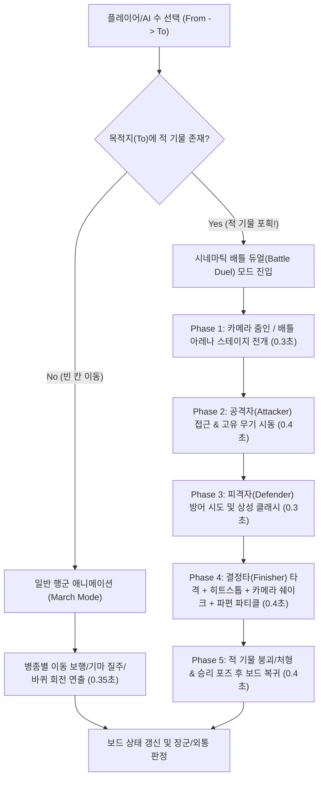
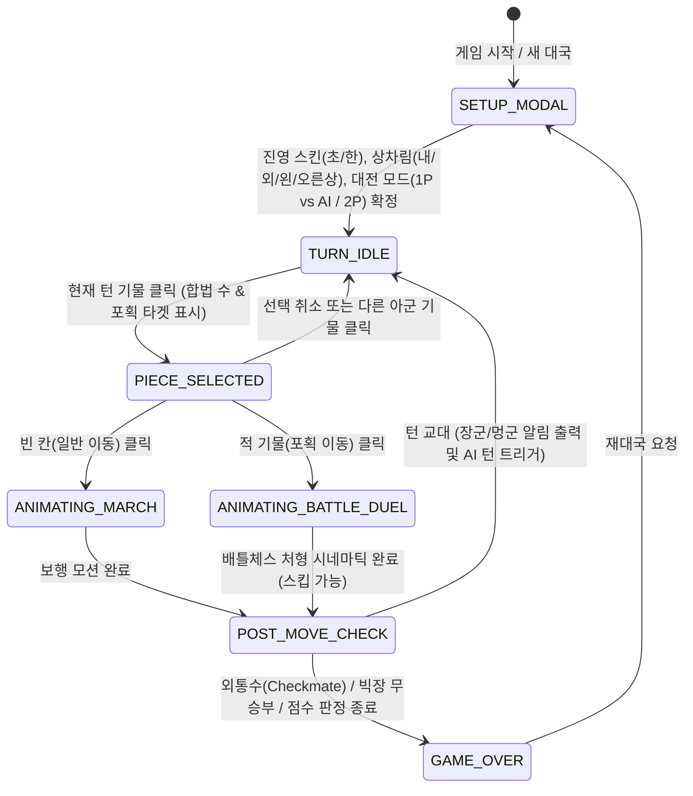

# 국가별 중세 정예병 스킨 기반 배틀체스형 장기 게임: 개발 툴 추천 및 통합 기획/기술 설계서 (GDD & TDD)

> **문서 버전**: v1.0  
> **작성자**: 수석 게임 기획자 및 시스템 아키텍트 (`game_planner`)  
> **대상 플랫폼**: Web (HTML5 Canvas / WebGL2), Linux 데스크톱, Windows Standalone (`.exe`)  

---

## 1. 개발 툴 및 게임 엔진 비교/추천 보고서

현재 개발 환경(Linux, Python 3.14, HTML5/Canvas/WebGL2 지원)에서 즉시 개발 및 테스트를 진행하고, 추후 **단일 코드베이스(Single Codebase)로 Windows 스탠드얼론(`.exe`) 배포**까지 달성하기 위한 엔진 후보군 비교 분석입니다.

### 1.1 후보 엔진/프레임워크 비교 매트릭스

| 평가 항목 | **1순위: Web-Native 하이브리드 엔진 (HTML5 Canvas/SVG/WebGL + Tauri/Electron/PyWebView)** | **2순위: Godot Engine 4 (GDScript / C#)** | **3순위: Unity Engine (C#)** |
| :--- | :--- | :--- | :--- |
| **즉시 개발/구동성** | **최상** (별도 에디터 설치 없이 브라우저 및 로컬 서버에서 즉시 60fps 실행) | **중** (에디터 바이너리 및 익스포트 템플릿 별도 설치 필요) | **하** (수십 GB의 에디터/허브 설치 및 무거운 초기 세팅) |
| **배틀체스 연출 적합도** | **최상** (다관절 2D 절차적 스켈레탈 애니메이션, 파티클, 셰이더, 시네마틱 카메라 줌 제어 용이) | **상** (2D AnimationPlayer 및 GPUParticles2D 우수) | **상** (3D 정통 배틀체스에 강점이나 2D/2.5D 제작 시 오버헤드 큼) |
| **스킨 시스템 확장성** | **최상** (JSON/JS 데이터 기반 파츠 조합, SVG/Canvas 동적 컬러 팔레트 및 무장 즉시 교체) | **상** (Resource/Scene 기반 스킨 교체 가능) | **중** (Prefab/AssetBundle 리빌드 필요) |
| **Windows `.exe` 패키징** | **최상** (Tauri, Electron, 또는 PyInstaller+PyWebView로 코드 수정 0%로 `.exe` 즉시 생성) | **상** (Windows Export Template 기반 크로스컴파일 지원) | **중** (플랫폼 모듈 설치 및 라이선스/로고 제약 존재) |
| **유지보수 및 AI 협업성** | **최상** (100% 텍스트 기반 모듈형 코드로 버전 관리 및 절차적 에셋 생성에 완벽 부합) | **중** (`.tscn`, `.tres` 등 엔진 고유 직렬화 포맷 혼재) | **하** (바이너리 메타데이터 및 거대 프로젝트 구조) |

---

### 1.2 최종 추천 아키텍처: 모듈형 HTML5 Canvas + 절차적 다관절 애니메이션 + 데스크톱 래퍼

지금 즉시 프로토타입부터 상용 수준 완성본까지 제작하고 Windows(`.exe`)로 배포하기에 **가장 이상적인 아키텍처**는 **[Modular ES6+ / HTML5 Canvas 2D·WebGL 하이브리드 렌더러 + 절차적 다관절 애니메이션(Procedural Skeletal Animation) + 데스크톱 네이티브 래퍼]** 구조입니다.

#### 핵심 선정 이유 4가지
1. **외부 이미지/3D 툴 의존성 제로 & 무제한 스킨 확장 (Procedural Skeletal Rigging)**
   - 각 기물(병종)을 투구(Helm), 갑주(Armor), 주무기(Main Weapon), 보조무기/방패(Off-hand), 탈것/공성기(Mount/Engine), 망토/깃발(Cape/Banner)의 **계층형 다관절(Bone/Joint Hierarchy) 벡터·캔버스 프리미티브**로 렌더링합니다.
   - 국가별 스킨(고려, 템플러, 비잔틴, 맘루크 등)을 변경할 때 무거운 스프라이트 시트를 다시 그릴 필요 없이, **스킨 정의 JSON/모듈의 파츠 형상 함수와 재질(금속 광택, 문양, 팀 컬러)**만 주입하면 모든 이동/공격/피격 애니메이션이 100% 동일하게 호환됩니다.
2. **배틀체스(Battle Chess) 특유의 시네마틱 카메라 & 타격감 구현 최적화**
   - 장기판 그리드 렌더링 레이어와 **시네마틱 듀얼 오버레이/줌인 카메라 매트릭스(`ctx.save()`, `ctx.translate()`, `ctx.scale()`)**를 자연스럽게 결합할 수 있습니다.
   - 히트스톱(Hit-stop, 타격 순간 프레임 정지), 카메라 쉐이크(Screen Shake), 궤적 잔상(Weapon Trail), 파편/스파크 파티클, Web Audio API 기반 절차적 타격 사운드 합성(검 부딪힘, 말발굽, 화포 폭발음)을 외부 에셋 파일 없이도 즉각 구현할 수 있습니다.
3. **정통 장기 규칙 및 AI 연산 분리 (Logic / View 완벽 분리)**
   - 순수 로직 모듈(`JanggiEngine`)은 렌더링과 완전히 분리되어 9x10 보드 상태, 합법 수 생성, 빅장/외통수 판정, Minimax + Alpha-Beta Pruning AI 연산을 고속 수행합니다.
   - 추후 Web Worker 분리나 Python 백엔드 연동, 멀티플레이어 서버 확장이 매우 쉽습니다.
4. **Windows 스탠드얼론(`.exe`) 100% 무수정 포팅 보장**
   - 웹 표준 API만 사용하므로, 완성된 게임 폴더를 그대로 감싸서 **Tauri**(Rust 기반, 설치파일 ~5MB 내외, 최저 메모리 점유), **Electron**(Node.js 기반, 최고 호환성), 또는 **Python `pywebview` + `PyInstaller`**를 통해 단일 실행 파일(`MedievalBattleJanggi.exe`)로 즉시 패키징할 수 있습니다.

---

## 2. 정통 한국 장기 규칙 엔진 설계 (Core Rule Engine TDD)

한국장기협회 공인 규칙을 기반으로 한 정밀한 보드/기물 규칙 엔진 설계입니다.

### 2.1 장기판(Board) 좌표계 및 궁성(Palace) 구조
- **보드 규격**: 가로 9줄(열, `x`: `0` ~ `8`), 세로 10줄(행, `y`: `0` ~ `9`)의 **교차점(Node)** 총 90개.
- **진영 배치**:
  - **한(Han / Red / 후공)**: 상단 진영 (`y = 0 ~ 4`), 궁성 범위 `x ∈ [3, 5]`, `y ∈ [0, 2]`, 궁성 중심 `(4, 1)`
  - **초(Chu / Blue / 선공)**: 하단 진영 (`y = 5 ~ 9`), 궁성 범위 `x ∈ [3, 5]`, `y ∈ [7, 9]`, 궁성 중심 `(4, 8)`
- **궁성 대각선(Palace Diagonals) 그래프**:
  - 궁성 내부에서도 모든 칸이 대각선으로 연결된 것이 아니라, **궁성 네 귀퉁이 ↔ 궁성 중심**을 잇는 직선만 대각선 이동이 허용됩니다.
  - 한(Han) 궁성 대각선 연결 노드: `(3,0) ↔ (4,1) ↔ (5,2)` 및 `(5,0) ↔ (4,1) ↔ (3,2)`
  - 초(Chu) 궁성 대각선 연결 노드: `(3,7) ↔ (4,8) ↔ (5,9)` 및 `(5,7) ↔ (4,8) ↔ (3,9)`

### 2.2 4대 상차림(Formation Setup) 선택 시스템
대국 시작 전 플레이어(및 AI)는 자신의 전술 스타일에 맞춰 **마(馬)와 상(象)의 초기 배치 4가지** 중 하나를 선택합니다. (좌/우는 각 진영에서 바라본 시점 혹은 보드 절대 열 기준으로 명확히 매핑)

| 상차림 명칭 | 코드 키 (`FormationType`) | 좌측 `(x=1, 2)` 배치 | 우측 `(x=6, 7)` 배치 | 전술적 특징 |
| :--- | :--- | :--- | :--- | :--- |
| **내상 (Inner Elephant)** | `INNER_ELEPHANT` | `(1)=마`, `(2)=상` | `(6)=상`, `(7)=마` | 중앙 방어력과 궁성 보호에 특화된 정석 수비형 배치 |
| **외상 (Outer Elephant)** | `OUTER_ELEPHANT` | `(1)=상`, `(2)=마` | `(6)=마`, `(7)=상` | 양 날개 기동력과 중앙 마(馬) 진출이 빠른 공격형 배치 |
| **왼상 (Left Elephant)** | `LEFT_ELEPHANT` | `(1)=상`, `(2)=마` | `(6)=상`, `(7)=마` | 좌측 상·우측 마 집중 운용에 유리한 비대칭 밸런스형 |
| **오른상 (Right Elephant)** | `RIGHT_ELEPHANT` | `(1)=마`, `(2)=상` | `(6)=마`, `(7)=상` | 우측 상·좌측 마 집중 운용에 유리한 비대칭 밸런스형 |

### 2.3 기물별 정밀 행마법 및 멱/다리 판정 알고리즘

| 기물 (한자/코드) | 기본 점수 | 이동 규칙 및 경로 막힘(Blocking) 판정 로직 |
| :--- | :---: | :--- |
| **궁/초·한 (`KING`)** | ∞ (목표) | **궁성(`3x3`) 내부 한정** 상하좌우 1칸 및 궁성 대각선 선분을 따라 1칸 이동. 궁성 밖 이탈 절대 불가. |
| **사 (`GUARD`)** | **3점** | 행마법은 궁(`KING`)과 100% 동일. 궁성 내부 상하좌우 및 궁성 대각선 1칸 이동. |
| **차 (`CHARIOT`)** | **13점** | 상하좌우 직선 무제한 이동. 또한 **궁성 대각선 시작점(귀퉁이/중심)에 위치할 경우 궁성 대각선을 따라 직선(1~2칸) 이동 가능**. 경로 중간에 기물이 있으면 넘어갈 수 없음. |
| **포 (`CANNON`)** | **7점** | 상하좌우 직선 및 **궁성 대각선(귀퉁이→중심→반대귀퉁이)** 경로에서 **반드시 정확히 1개의 기물(다리/Screen)을 뛰어넘어야만** 이동 또는 포획 가능.<br>**[포 특수 금지 규칙]**:<br>1) **포 넘기 불가**: 다리(넘는 기물)가 아군/적군을 막론하고 `CANNON(포)`일 수 없음.<br>2) **포 잡기 불가**: 도착 지점의 포획 대상이 적군 `CANNON(포)`일 수 없음. |
| **마 (`HORSE`)** | **5점** | 직선(상하좌우) 1칸 전진 후, 외곽 대각선 1칸 이동 (총 8방향 L자 행마).<br>**[마의 멱(길목) 판정]**: 첫 직선 1칸 지점 `(x + dx, y + dy)`에 아군 또는 적군 기물이 존재하면 해당 방향의 2개 대각선 목적지 모두 이동 불가. |
| **상 (`ELEPHANT`)** | **3점** | 직선(상하좌우) 1칸 전진 후, 같은 방향 외곽 대각선으로 **2칸** 연속 이동 (총 8방향 확장 L자 행마).<br>**[상의 멱(2중 길목) 판정]**:<br>1) 첫 번째 멱: 직선 1칸 지점 `(x + dx, y + dy)`이 비어 있어야 함.<br>2) 두 번째 멱: 대각선 1칸 경유지 `(x + 2*dx_step, y + 2*dy_step)` 또한 비어 있어야 최종 목적지 도달 가능. |
| **졸/병 (`SOLDIER`)** | **2점** | **전진 1칸 또는 좌/우 1칸** 이동 (후진 절대 불가).<br>- 초(Chu)의 졸: `dy = -1` (위로 전진), `dx = ±1`<br>- 한(Han)의 병: `dy = +1` (아래로 전진), `dx = ±1`<br>- **궁성 진입 시 특권**: 적 궁성(또는 궁성 대각선 노드)에 진입하면 **후진이 아닌 전진 방향의 궁성 대각선 1칸 이동**이 추가로 활성화됨. |

### 2.4 장군(Check), 멍군, 외통수(Checkmate), 빅장(Bikjang), 기물 점수제

1. **합법 수(Legal Move) 필터링과 자살수 방지**:
   - 모든 의사 합법 수(Pseudo-legal moves)에 대해 가상 보드에서 수를 실행한 뒤, **내 궁(`KING`)이 적 기물의 공격 사거리에 노출되는지(`isKingInCheck(board, mySide)`)** 검증합니다. 노출되는 수는 원천 차단합니다.
2. **장군(Check)과 멍군(Check Defense)**:
   - 턴 종료 시 상대방 궁(`KING`)이 공격받고 있으면 **'장군!'** 이벤트와 시각/청각 경고를 발생시킵니다.
   - 장군을 받은 진영이 다음 턴에 장군 상태를 해소하는 합법 수를 두면 **'멍군!'** 연출이 출력됩니다.
3. **외통수(Checkmate) 및 무승부/기권**:
   - 현재 턴 진영이 생성할 수 있는 합법 수가 **0개**일 때:
     - 현재 장군 상태라면 → **외통수(Checkmate) 패배**.
     - 장군 상태가 아니라면 → **초완봉(Stalemate) 패배 또는 빅 처리**.
4. **빅장(Bikjang, 왕끼리 마주보기) 규칙**:
   - 초(Chu)의 궁과 한(Han)의 궁이 같은 세로줄(`x` 좌표 동일)에 위치하고, 두 궁 사이에 **아무 기물도 없는 상태**를 빅장 조건으로 정의합니다.
   - 한쪽이 궁을 노출시켜 두 왕이 마주보게 만들었을 때(빅장 선언), 상대방이 이를 피하지 않고 한 수 쉼(또는 빅장 수용)을 택하면 **무승부(빅)**로 처리하거나, 설정에 따라 점수 판정 승부로 전환할 수 있도록 옵션화합니다.
5. **기물 점수제 및 덤(Komidashi) 계산**:
   - 기물 점수 합산 공식:
     $$\text{Score} = 13 \times N_{\text{차}} + 7 \times N_{\text{포}} + 5 \times N_{\text{마}} + 3 \times N_{\text{상}} + 3 \times N_{\text{사}} + 2 \times N_{\text{졸}} + \text{덤}$$
   - **초(Chu, 선공) 초기 총점**: $13\times2 + 7\times2 + 5\times2 + 3\times2 + 3\times2 + 2\times5 = \mathbf{72.0\text{점}}$
   - **한(Han, 후공) 초기 총점**: 기본 $72.0\text{점} + \text{덤 } 1.5\text{점} = \mathbf{73.5\text{점}}$
   - 소수점(`.5`) 덤이 존재하므로 점수 판정 시 무승부가 발생하지 않으며, 상단 UI 대시보드에 실시간으로 양 진영의 현재 기물 점수와 우세 게이지를 표시합니다.

---

## 3. 배틀체스(Battle Chess) 연출 시스템 아키텍처

단순히 기물 알이 겹쳐지며 사라지는 일반 장기와 달리, 본 프로젝트의 핵심 정체성은 **기물 포획 시 펼쳐지는 중세 정예병들의 처절한 근접/사격/공성 전투 애니메이션**입니다.



### 3.1 일반 이동(March Mode) vs 공격 이동(Battle Duel Mode) 분기
1. **일반 이동 (Non-Capture Move)**:
   - 보드 위에서 기물이 이동할 때 단순 슬라이딩이 아니라 병종별 고유 보행 모션을 재생합니다.
   - 보병(`SOLDIER`, `GUARD`, `KING`): 다리 교차 보행 및 방패/무기 흔들림(Bobbing).
   - 기병/전투코끼리(`HORSE`, `ELEPHANT`): 도약 포물선 궤적 + 착지 시 흙먼지 파티클.
   - 공성전차/화포(`CHARIOT`, `CANNON`): 바퀴 회전 + 육중한 진동 및 궤적 자국.
2. **배틀 듀얼 연출 모드 (Battle Duel Cinematic Mode)**:
   - 적 기물을 잡는 수(`captureMove`)가 발생하면 즉시 게임 상태가 `STATE_BATTLE_CINEMATIC`으로 전환됩니다.
   - **연출 모드 옵션 제공**:
     - `ARENA_OVERLAY` (기본): 화면 중앙에 국가 테마가 반영된 중세 결투장(Battle Stage) 배너/스테이지가 펼쳐지며 공격자와 방어자가 2.5배 확대된 고디테일 다관절 캐릭터로 맞붙습니다.
     - `BOARD_ZOOM`: 장기판 교차점을 중심으로 카메라가 급격히 줌인(Zoom-in)되며 보드 위에서 직접 처형 모션이 펼쳐집니다.
     - `FAST_KILL`: 빠른 대국을 원할 때 대기 시간 없이 보드 위에서 즉각 참격/폭발 이펙트로 처치합니다.

### 3.2 병종별 고유 공격/처형 모션 매트릭스 (Unit Class Combat Choreography)

모든 기물은 자신의 병종 등급과 무기 체계에 맞는 고유한 **시동(Wind-up) → 타격(Strike) → 피니셔(Execution)** 시퀀스를 가집니다.

| 공격 기물 | 중세 병종 아키타입 | 배틀 듀얼 공격 & 처형 연출 시퀀스 | 특수 이펙트 (VFX / SFX) |
| :--- | :--- | :--- | :--- |
| **궁 (`KING`)** | **국왕 / 대주교 / 술탄 친위 지휘관** | 황금 대검(또는 왕홀)을 치켜들어 신성한 빛/왕의 위엄으로 적의 방어를 강제로 무너뜨린 뒤, 단숨에 내려베는 위엄 있는 처형 모션 | 황금빛 충격파 링, 번개/성광 슬래시, 묵직한 대검 참격음 |
| **차 (`CHARIOT`)** | **중장갑 공성 전차 / 철갑 파성추 / 최정예 중기병** | 거대한 회전 칼날 바퀴(또는 롱랜스 중기병 돌격)가 풀스피드로 가속하며 적의 방패를 산산조각내고 그대로 들이받아 날려버리는 압도적 파괴 연출 | 강철 파편 폭발, 강렬한 카메라 쉐이크, 말발굽/전차 굉음 |
| **포 (`CANNON`)** | **공성 사석포 / 트레뷰셋(투석기) / 그리스의 불 화포** | 포신이 뒤로 밀리는 강력한 반동과 함께 포구 화염 분출 → 포탄이 곡선을 그리며 적 머리 위에서 직격 폭발하여 적을 그을린 파편으로 분쇄 | 포구 화염(Muzzle Flash), 흑연 연기 구름, 붉은 화염 폭발 파티클 |
| **마 (`HORSE`)** | **중장갑 기마 돌격병 (Lancer / Cataphract)** | 군마가 앞발을 높이 치켜들며 포효(Rearing)한 뒤 전속력 질주, 기창(Lance) 또는 기병도로 적을 꿰뚫어 공중으로 띄우는 기마 돌격 연출 | 창끝 섬광, 고속 관통 궤적선(Speed Lines), 말 울음소리 |
| **상 (`ELEPHANT`)** | **전투 코끼리(War Elephant) / 대형 공성 망루** | 거대 갑주 코끼리가 긴 코와 상아를 휘둘러 적을 공중에 띄운 뒤, 거대한 앞발로 대지를 짓밟아(Stomp) 충격파로 제압하는 괴력 연출 | 대지 균열 이펙트, 흙먼지 기둥, 묵직한 저음 진동(Sub-bass) |
| **사 (`GUARD`)** | **왕실 근위대 (Royal Halberdier / Palace Guard)** | 대형 방패로 적의 선공을 완벽히 튕겨낸(Parry) 직후, 할버드/미늘창으로 정교하게 급소를 찌르고 베어내는 숙련된 연격 연출 | 방패 패링 불꽃(Sparks), 날카로운 2연속 참격 궤적 |
| **졸/병 (`SOLDIER`)** | **정예 보병 (Footman / Spearmen / Janissary)** | 함성을 지르며 방패 밀치기(Shield Bash)로 적의 중심을 무너뜨리고 단검/장창으로 치열하게 찌르는 처절한 백병전 연출 (상급 기물 처치 시 '하극상/자이언트 킬링' 특수 연출!) | 거친 금속 마찰음, 보병 돌격 함성, 자이언트 킬링 크리티컬 이펙트 |

---

## 4. 국가별 중세 진영 스킨 교체 시스템 (Faction Skin System)

플레이어는 대국 시작 전 **초(Chu, 선공)**와 **한(Han, 후공)** 각각에 원하는 **중세 국가 정예병 테마 스킨**을 독립적으로 지정할 수 있습니다. (예: 고려 철갑군 vs 템플러 기사단, 비잔틴 제국군 vs 맘루크 술탄국 등 자유로운 드림매치 가능)

### 4.1 4대 중세 국가 정예병 스킨 라인업 기획

| 기물 | **1. 고려 철갑군 (Goryeo Iron Army)** | **2. 성전 기사단 (Templar Crusaders)** | **3. 비잔틴 제국군 (Byzantine Empire)** | **4. 맘루크 술탄국 (Mamluk Sultanate)** |
| :--- | :--- | :--- | :--- | :--- |
| **테마 컬러** | 감청색(Indigo) & 흑철/적금 장식 | 백색(White) 서코트 & 붉은 십자가/은빛 강철 | 제국 자색(Tyrian Purple) & 황금 비늘갑주 | 사막 황금빛(Sand Gold) & 에메랄드/다마스쿠스 강철 |
| **궁 (`KING`)** | **고려 황제/대장군** (익선관·황금 두정갑·사인검) | **그랜드 마스터** (왕관 그레이트헬름·성검·십자 망토) | **바실레우스 황제** (제국 보관·자색 망토·쌍두독수리 홀) | **맘루크 술탄** (황금 터번 투구·보석 시미터·초승달 문장) |
| **차 (`CHARIOT`)** | **중장갑 검차(劍車)** (다연장 창날 바퀴 전차) | **헤비 저거너트 전차** (철십자 파성추 장갑 마차) | **카타프락토이 중전차** (전신 미늘갑주 돌격 전차) | **사막 화염 전차** (거대 곡도 바퀴 돌격 전차) |
| **포 (`CANNON`)** | **신기전 화차 / 대장군포** (화약 로켓 다연장 포차) | **크루세이더 트레뷰셋** (성벽 파괴용 중형 투석포) | **그리스의 불 방사포** (청동 사이펀 화염 포차) | **오스만/맘루크 대포** (거대 청동 사석포) |
| **마 (`HORSE`)** | **고려 개마무사** (철갑마 + 장창/환도 기병) | **템플러 랜서 나이트** (백마 + 붉은 십자 마갑 + 랜스) | **클리바나리 중기병** (황금 마갑 + 콘토스 장창) | **파리스 정예 기병** (아라비안 명마 + 기마 곡도) |
| **상 (`ELEPHANT`)** | **중장갑 공성 코끼리** (동양풍 누각 망루 + 철갑 코끼리) | **성전 이동식 공성탑** (십자가 방패가 달린 거대 전투 코끼리/공성수) | **인도산 제국 전투 코끼리** (비잔틴 황금 갑주 코끼리) | **무굴/맘루크 전쟁 코끼리** (초승달 황금 투구 + 상아 칼날 코끼리) |
| **사 (`GUARD`)** | **견룡군 금군 호위병** (경번갑 + 월도/방패) | **성전 근위 팔라딘** (카이트 실드 + 할버드) | **바랑기안 가드** (원형 방패 + 양손 데인액스 도끼) | **술탄 친위 맘루크** (원형 금장 방패 + 쌍곡도) |
| **졸/병 (`SOLDIER`)** | **고려 장창 보병** (두정갑 + 팽배 방패 + 장창) | **크루세이더 중보병** (사슬갑옷 + 십자 방패 + 브로드소드) | **스쿠타토이 중보병** (타원형 방패 + 스파타 검/창) | **구람/가즈 보병** (터번 투구 + 라운드 실드 + 시미터) |

### 4.2 데이터 기반 스킨 렌더러 설계 (`SkinRegistry` & `ProceduralUnitRenderer`)

각 국가 스킨은 하드코딩된 조건문이 아니라 **선언형 스킨 스키마(Declarative Skin Schema)**로 정의됩니다.

```javascript
// 스킨 데이터 스키마 예시 (src/data/skins.js)
export const FACTION_SKINS = {
  GORYEO: {
    id: 'GORYEO',
    name: '고려 철갑군 (Goryeo Iron Army)',
    subtitle: '개마무사와 신기전 화차로 무장한 동방의 철갑 정예군',
    palette: {
      primary: '#1e3a8a',    // 감청색 갑주 포
      secondary: '#991b1b',  // 붉은 투구 드림/끈
      metal: '#64748b',      // 흑철 광택
      gold: '#f59e0b',       // 황금 장식
      emblem: 'SAMJOKOH'     // 삼족오/고려 문양
    },
    units: {
      CHARIOT: { title: '중장갑 검차', helmStyle: 'GORYEO_CONE', weaponStyle: 'BLADE_CHARIOT',fxColor: '#38bdf8' },
      CANNON:  { title: '신기전 화차', helmStyle: 'GORYEO_CONE', weaponStyle: 'HWACHA_ROCKET', fxColor: '#f97316' },
      HORSE:   { title: '개마무사',   helmStyle: 'IRON_MASK',   weaponStyle: 'HEAVY_SPEAR',   fxColor: '#60a5fa' },
      // ...
    }
  },
  TEMPLAR: {
    id: 'TEMPLAR',
    name: '성전 기사단 (Templar Crusaders)',
    // ...
  }
};
```

---

## 5. 모듈형 소프트웨어 아키텍처 및 Windows 패키징 설계

### 5.1 프로젝트 디렉토리 구조
```text
/home/janginwoo/Desktop/GAME/
├── index.html                  # 메인 엔트리 (반응형 UI, 대국 설정 모달, 배틀체스 캔버스 스테이지)
├── css/
│   └── style.css               # 중세 판타지/역사 전략풍 다크 골드 UI 테마 및 HUD 스타일
├── src/
│   ├── main.js                 # 애플리케이션 부트스트랩 및 게임 루프(requestAnimationFrame) 제어
│   ├── core/
│   │   ├── constants.js        # 기물 타입, 상차림 4종, 점수(13/7/5/3/3/2, 덤 1.5), 궁성 좌표 상수
│   │   ├── JanggiEngine.js     # 정통 장기 규칙 엔진 (멱/포 다리/궁성 대각선/장군/외통수/빅장 판정)
│   │   └── AIController.js     # 난이도별 AI (Minimax + Alpha-Beta Pruning + 위치 가중치 테이블)
│   ├── skins/
│   │   └── FactionSkins.js     # 국가별 4대 중세 스킨(고려, 템플러, 비잔틴, 맘루크) 팔레트 및 무장 데이터
│   ├── rendering/
│   │   ├── BoardRenderer.js    # 9x10 중세 전략 장기판, 궁성 대각선, 합법 수 하이라이트, 기물 토큰/미니어처 렌더링
│   │   ├── UnitRigRenderer.js  # 다관절 절차적 중세 유닛 렌더러 (투구/갑옷/방패/무기/군마/화포/코끼리 드로잉)
│   │   └── BattleDirector.js   # 배틀체스 시네마틱 연출기 (줌인/아레나 스테이지, 병종별 타격/처형 모션, 파티클)
│   └── audio/
│       └── SoundSynthesizer.js # Web Audio API 기반 무에셋 절차적 효과음 (검격, 기마 질주, 화포 폭발, 장군 북소리)
├── packaging/
│   └── windows_build_guide.md  # Windows .exe 스탠드얼론 패키징 스크립트 및 가이드 (PyWebView/Electron/Tauri)
└── docs/
    └── 02_architecture_and_game_plan.md
```

### 5.2 핵심 상태 머신 (Game State Machine)


### 5.3 Windows 스탠드얼론(`.exe`) 빌드 파이프라인 설계
추후 Windows 환경에서 단일 `.exe` 파일로 빌드할 때 아래 2가지 공식 파이프라인을 즉시 사용할 수 있도록 구성합니다.

1. **방식 A: Python `pywebview` + `PyInstaller` (가장 간편한 단일 `.exe` 생성)**
   - Python 환경이 이미 갖춰져 있으므로 `launcher.py` (약 25줄)로 로컬 웹앱을 네이티브 윈도우 창으로 띄우고, `pyinstaller --onefile --windowed --add-data "...;." launcher.py` 명령 하나로 **`MedievalBattleJanggi.exe`**를 즉시 생성합니다.
2. **방식 B: Tauri v2 또는 Electron Builder**
   - 크로스 플랫폼 인스톨러(`.msi`, `.exe`) 배포 시 웹 에셋 디렉토리(`dist/`)를 그대로 지정하여 네이티브 데스크톱 앱으로 패키징합니다.
