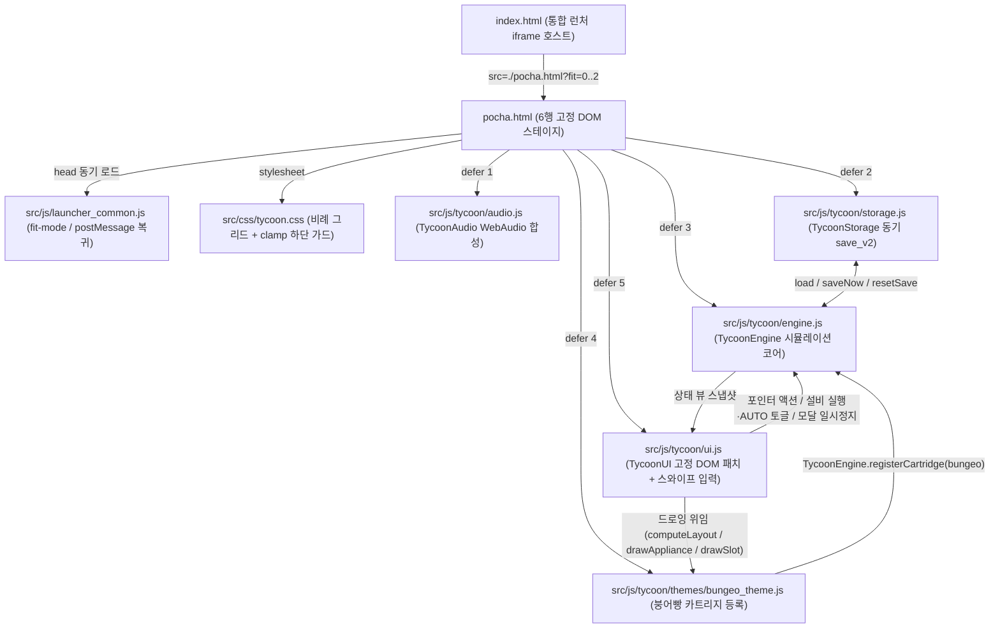

# 전설의 붕어빵 타이쿤 재설계 및 카트리지형 조리 엔진 분리

*   **Author:** et6065-ship-it
*   **Status:** Approved
*   **Date:** 2026-11-10

--------------------------------------------------------------------------------

## Overview

본 문서는 모바일 웹앱 통합 런처([`index.html`](../../index.html))에서 구동되는 전설의 붕어빵 타이쿤([`pocha.html`](../../pocha.html))을 재설계하기 위한 기술 명세다. 기존 `2,208줄` 단일 HTML 파일을 **테마 중립 타이쿤 코어 엔진(`src/css/tycoon.css`, `src/js/tycoon/*`)**과 **한국 붕어빵 요리 카트리지(`src/js/tycoon/themes/bungeo_theme.js`)**로 분리한다. 초반에는 개별 슬롯 수동 조리와 회당 원가 지출·무허가 현장 점검 대응을 수행하고, 중·후반에는 단계형 편의 설비 토글·3칸 메뉴 편성·전국 6대 출장·강남 5층 타워 증축 중심으로 운영 방식을 전환한다.

문서 전반에서 사용하는 핵심 용어의 정의는 다음과 같다.
*   **타이쿤 코어(Tycoon Core):** 특정 음식에 종속되지 않는 경제 정산(현금·원가·매출·비상 구제), 손님 대기열(최대 3칸), 보온 진열대(트레이별 상한 `12마리`), 설비 해금·자동 토글, 모달 일시정지, 동기 세이브 직렬화를 담당하는 공통 실행 계층이다.
*   **요리 카트리지(Cooking Cartridge):** 개별 요리 테마(이번 출시 범위: `bungeo`)의 선언적 조리 단계 배열(`cookingPhases[]`), 레시피 원가·단가, 주물틀 격자 규격(`cols×rows`), 캔버스 드로잉 콜백, 출장지·타워·컷신·캠페인 설정 테이블(`campaignRules`)을 코어에 등록하는 데이터·렌더 모듈이다.
*   **활성 메뉴 로드아웃(Active Menu Loadout):** 해금된 전체 레시피(6종) 중 현재 영업 화면의 하단 재료 선택 바와 중앙 보온 진열대에 동시에 배치하는 최대 3종의 주력 판매 메뉴 편성이다.
*   **뷰포트 하단 예약(`--app-fit-bottom-reserve`):** 공통 어댑터 [`launcher_common.js`](../../src/js/launcher_common.js)가 `<html data-fit-mode>` 단계(`최대 0: 12px`, `보통 1: 64px`, `축소 2: 108px`)에 따라 주입하는 하단 안전 여백 CSS 변수다.

## The Problem

현재 [`pocha.html`](../../pocha.html)은 프로토타입 검증용 치트 설정과 단일 파일 결합 구조가 남아 있어 다음 4가지 결함을 안고 있다.

1.  **초반 경제 및 진행 조건 왜곡:** 초기 보유 자금이 `35,000원`으로 지급되고 반죽 투입 원가가 `0원`이며, 시작 시점부터 일괄 조작 버튼 3종(`모두 붓기`, `모두 뒤집기`, `진열대로 올리기`)이 조건 없이 개방되어 있다. 또한 스토리 모달 내부에 치트 버튼(`"⚡ 즉시 클리어"`, `L2085`)이 노출되어 있고, 강남 타워 `1~4층`을 건설하지 않아도 누적 수확 `30마리`만으로 최종 5층 건물주 엔딩이 클리어(`L1104`)된다.
2.  **대본·삽화·코드 간 5중 데이터 불일치:** 정본 대본 [`05_bungeo_youth_story_script.md`](../05_bungeo_youth_story_script.md) 및 삽화 7종과 비교할 때 현행 코드는 다음 5가지 불일치를 보인다.
    *   ① 대본 프롤로그는 `3구 무쇠틀` 시작을 정의하나 현행 코드는 `2×2(4구)` 틀로 시작한다.
    *   ② 제1장 클리어 보상을 먼저 수령하면 `mold_6`이 무상 지급되어 상점 구매 분기에서만 호출되는 [`bungeo_ep2_5_mold_craft_upgrade.jpg`](../../assets/story_bungeo/bungeo_ep2_5_mold_craft_upgrade.jpg) 컷신이 우회·누락된다.
    *   ③ 대본의 전국 6대 출장지 중 `홍대·성수`와 `전주 한옥마을` 2곳이 빠져 있다.
    *   ④ 무허가 노점 상태에서도 최종 휴양지인 제주도 출장 진입이 가능하다.
    *   ⑤ 정식 영업허가증 버프가 대본(`단속 면역 + 인내심 +15% + 단가·팁 +20%`) 대신 단순 단가 `+30%`로만 적용되어 있다.
3.  **모바일 터치 입력 유실 및 백그라운드 타이머 진행:** 메인 루프가 `0.35초`마다 손님 카드, 진열대, 하단 재료 바의 `innerHTML`을 빈 문자열로 초기화하고 노드를 재생성(`L1740-L1830`, `L2164`)하기 때문에 모바일 사용자의 `pointerdown`과 `pointerup` 사이에 DOM 노드가 삭제되어 탭 입력이 증발한다. 또한 상점·스토리 모달이 열려 있거나 탭이 비활성(`document.hidden`) 상태일 때도 `READY` 상태 슬롯의 `16초` 과열 타이머와 손님 인내심이 계속 차감된다.
4.  **요리 확장 불가 구조 및 소형 뷰포트 레이아웃 압축:** 붕어빵 전용 2단계 굽기 enum(`FRONT -> FLIP_READY -> BACK`), 상단 20% 경첩 뚜껑 캔버스 드로잉, CSS 가상요소 간판 문구가 단일 파일에 결합되어 향후 타코야키·화덕 요리로 확장하려면 전체 파일을 새로 작성해야 한다. 또한 `360×640` 기기에서 런처 `축소(108px)` 모드를 적용한 `532px` 유효 높이에서 고정 상단 뚜껑 높이가 불판 영역을 잠식해 `3×3` 슬롯의 개별 터치 높이가 `21px` 수준으로 축소된다.

**제안 해법 요약:** 상단 HUD를 포함한 6행 고정 스테이지(`상단 HUD -> 손님 대기열 -> 보온 진열대 -> 조리 캔버스 -> 3열 조리 액션 바 -> 3칸 활성 재료 바`)를 유지한 채 코어 시뮬레이션과 카트리지 데이터를 분리한다. 초반에는 `3,000원` 시재금·회당 반죽 원가·과열 판정·손님 슬롯 내장형 25초 현장 점검(파산 방지 구제 포함)으로 수동 조리 과제를 부여하고, 중·후반에는 연속 브러시 스와이프·단계형 편의 설비 5종·3칸 메뉴 로드아웃 편성·전국 6대 출장·강남 5층 순차 증축으로 자동화 및 경영 선택 중심 플레이로 전환한다.

## Goals

*   **모듈 분리 및 `file://`·런처·Node 호환 유지:** [`pocha.html`](../../pocha.html)을 진입 마크업으로 유지하면서 스타일(`src/css/tycoon.css`), 타이쿤 코어(`src/js/tycoon/*`), 붕어빵 카트리지(`src/js/tycoon/themes/bungeo_theme.js`)로 분리하고, 번들러나 `<script type="module">` 없이 로컬 `file://`, 정적 웹서버, 통합 런처 `<iframe allow="fullscreen">`, 헤드리스 Node 테스트 환경 모두에서 동작시킨다.
*   **선언적 카트리지 계약 확립:** 코어 코드(`engine.js`, `ui.js`) 내 붕어빵 고유 식별자·대사 문자열을 제거하고, 가변 길이 조리 단계 배열(`cookingPhases[]`)의 `actionId` 동적 매칭과 캔버스 드로잉 콜백만으로 주물틀형·철판 굴리기형·화덕형 조리 공정을 수용한다.
*   **단계적 타이쿤 경제 및 설비 전환 구현:** 초기 시재금 `3,000원`, 회당 재료 원가 차감, 과열 판정, 25초 무허가 현장 점검, 편의 설비 5종(`일괄 반죽기`, `연동 회전 핸들`, `정밀 온도 센서`, `자동 수확 트레이`, `김민지 매니저`) 유료 해금을 통해 개별 슬롯 수동 조작에서 자동 설비 토글 및 3칸 메뉴 편성 중심 운영으로 전환한다.
*   **파산 및 배압 교착 `0건` 달성:** `gold < minActiveRecipeCost && activeCookingSlots === 0 && (totalRackStock === 0 || (waitingCustomers.length > 0 && !canServeAnyWaitingCustomer))` 조건 진입 시 즉시 구제 자금을 지급하고, 진열대 상한(`12마리`) 초과 수확분을 무상태 도매 정산하여 불판 봉쇄와 파산 교착을 차단한다.
*   **정본 스토리 및 7종 삽화 전수 도달 복원:** [`05_bungeo_youth_story_script.md`](../05_bungeo_youth_story_script.md)의 전국 6대 출장지, 정식 영업허가증 제1호 버프, 강남 타워 `1층~5층` 순차 건설 조건, `assets/story_bungeo/*.jpg` 7종 삽화 전체가 정상 진행 경로에서 호출되도록 매핑하고 프로덕션 치트 버튼을 제거한다.
*   **모바일 입력 무결성 및 소형 뷰포트 슬롯 높이 확보:** 주기적 `innerHTML` 재생성을 제거하고, 모달 오픈·탭 비활성 시 시뮬레이션 `tick(0)`을 동결하며, `360×640` 기기의 `fit=2`(`108px` 예약, 유효 높이 `532px`) 환경에서도 `3×3` 슬롯 개별 터치 높이를 `42px` 이상으로 유지한다.
*   **동기 세이브 격리 및 PWA 캐시 버전 갱신:** 신규 `tycoon_engine_save_v2` 키에 이산 이벤트 즉시 동기 저장을 수행하여 `<iframe>` 언마운트 시 데이터 유실과 구버전 세이브 오염을 막고, [`sw.js`](../../sw.js) `CACHE_NAME`을 `v6`으로 상향해 구버전 단일 파일 캐시를 파기한다.

## Non-Goals

*   **타코야키 및 해외 화덕 요리 캠페인 콘텐츠 제작:** 이번 작업에서는 다종 요리 확장을 수용하는 코어·카트리지 인터페이스와 검증까지만 수행하며, 타코야키·피자 등의 실제 레시피·스토리·일러스트 에셋 제작은 후속 카트리지 작업으로 분리한다.
*   **리듬게임 타이밍 링 판정 도입:** 박자 노트에 맞춰 탭하는 리듬 판정 시스템은 후반 설비 자동화 운영 목표와 충돌하므로 구현하지 않는다.
*   **다중 화면 기업 시뮬레이터 및 유행 순환 타이머 추가:** 단일 세로 스테이지 바깥에 별도의 월드맵 화면이나 재무제표 화면을 추가하지 않으며, 후반 운영 피로를 유발하는 주기적 출장지 유행 순환 타이머도 두지 않는다.
*   **레거시 Python 코드베이스 및 빌드 도구 변경:** `pocha_tycoon/` 하위 Python/Pygame 파일은 읽기 전용 아카이브로 동결하며, Vite·Webpack 등 외부 번들러나 백엔드 API 서버는 도입하지 않는다.

## Open Questions

*   없음 (모든 설계 기준이 본문 아키텍처 명세에 확정 반영됨).

## Critical User Journeys (CUJs)

### CUJ 1: 초반 역전 앞 수동 슬롯 조리 및 연속 브러시 스와이프

*   **Given**: 플레이어가 새 게임을 시작하여 프롤로그 컷신 확인 후 역전 3번 출구 포차(`3×1` 3구 무쇠틀, 초기 시재금 `3,000원`, `통단팥` 단일 활성 메뉴, 편의 설비 미해금 상태)에 진입해 있다.
*   **When**: 플레이어가 불판 캔버스의 빈 슬롯 3칸 위를 손가락으로 훑고 지나가며(Brush-Swipe), 앞면 가열 완료(`wait_flip`) 후 다시 스와이프하여 뒤집고, 뒷면 가열 완료(`wait_harvest`) 후 스와이프하여 보온 진열대로 수확한 뒤 손님 카드를 탭해 서빙한다.
*   **Then**:
    *   슬롯 투입마다 통단팥 1회 원가(`300원`)가 차감된다.
    *   `wait_flip` 또는 `wait_harvest`에서 과열 제한 시간을 넘기지 않은 완성 붕어빵이 진열대에 적재된다.
    *   손님 주문 수량 충족 시 판매 대금과 콤보 팁이 입금되고 `tycoon_engine_save_v2`에 동기 저장된다.

### CUJ 2: 무허가 노점 25초 현장 점검 통과 및 『구청 정식 영업허가증 제1호』 취득

*   **Given**: 플레이어가 제1장 클리어 이후 무허가 노점 상태(`licensed === false`)이며 일반 손님 `6명` 처리 주기에 도달해 손님 슬롯 3칸 중 빈자리가 생겼다.
*   **When**: 강원칙 주무관이 손님 슬롯 1칸에 등장하여 `25초` 현장 점검을 시작하고, 플레이어가 불판의 `BURNT` 슬롯을 탭해 비운 뒤 완성 붕어빵 `2마리`를 제출한다(제1장 클리어 이후 상점에서 `3×2` 6구 회전틀 `mold_6`을 구매·장착하여 제2장 요건을 충족한다).
*   **Then**:
    *   점검 통과 시 `inspectPasses`가 `+1` 증가하고 격려금 `+1,000원`이 지급된다.
    *   제2장 요건 달성 시 [`bungeo_ep1_8_official_permit.jpg`](../../assets/story_bungeo/bungeo_ep1_8_official_permit.jpg) 컷신과 함께 `구청 정식 영업허가증 제1호` 영구 효과(단속 면역, 손님 인내심 `+15%`, 판매 단가·팁 `+20%`) 및 전국 6대 푸드트럭 출장 탭이 개방된다.
    *   점검 제한 시간을 넘기더라도 게임오버되지 않으며, `4초`간 불판 청소 대기(타 슬롯 과열 타이머 동시 정지)와 차감 후 잔액 하한(`minActiveRecipeCost * 2`)을 보존하는 최대 `1,000원` 과태료만 적용된다.

### CUJ 3: 현금 및 서빙 가능 재고 소진 시 파산 방지 비상 구제 발동

*   **Given**: 플레이어가 연속 과열 폐기 등으로 보유 현금이 현재 활성 로드아웃 최저 원가(`minActiveRecipeCost`) 미만이고, 조리 중인 정상 슬롯이 `0개`이며, 진열대 총재고가 `0`이거나 현재 대기 중인 손님 누구에게도 즉시 서빙할 수 없는 상태다.
*   **When**: 코어 시뮬레이션이 `tick()`에서 해당 파산 교착 조건을 감지한다.
*   **Then**: 시뮬레이션이 멈추지 않고 구제 알림 토스트(*할머니의 비상 동전주머니 / 단골 이지은의 선결제 응원*)와 함께 `minActiveRecipeCost * 4` 금액이 즉시 지급된다.

### CUJ 4: 중·후반 편의 설비 해금, 3칸 메뉴 로드아웃 편성 및 강남 5층 타워 완공

*   **Given**: 정식 허가증을 취득한 플레이어가 상점에서 `3×2(6구)` -> `3×3(9구)` 주물틀과 편의 설비 5종을 순차 해금하고 전국 6대 출장지를 개척 중이다.
*   **When**: 플레이어가 출장지 선호 메뉴에 맞춰 6종 속재료 중 `3칸 활성 메뉴 로드아웃`을 교체하고 조리 액션 바의 `[AUTO]` 토글과 상점 내 패시브 설비 스위치를 켜 자동 조리·서빙을 가동하며, 누적 수익으로 강남 타워 `1층`부터 `5층`까지 순서대로 완공한다.
*   **Then**:
    *   하단 재료 바, 조리 액션 바, 진열대는 모두 3열 폭(`360px` 기준 카드당 `>= 104px`)을 유지한다.
    *   `mold_6` 구매 시 [`bungeo_ep2_5_mold_craft_upgrade.jpg`](../../assets/story_bungeo/bungeo_ep2_5_mold_craft_upgrade.jpg)를 포함한 7종 삽화가 모두 정상 호출된다.
    *   `5층 루프탑 황금 붕어 동상` 완공 시 최종 엔딩 컷신이 출력된 뒤 무제한 경영 모드로 이어진다.

### CUJ 5: 통합 런처 `<iframe>` 내 소형 뷰포트 구동, 모달 일시정지 및 런처 복귀

*   **Given**: 사용자가 통합 런처([`index.html`](../../index.html))에서 전체화면 진입 및 `화면 크기 조절: 축소(108px)` 설정 상태로 전설의 붕어빵 타이쿤을 실행했다.
*   **When**: 조리 도중 스토리 또는 상점 모달을 열어 내용을 확인한 뒤 닫고, 상단 `[🎮 런처]` 복귀 링크 또는 기기 뒤로가기 버튼을 누른다.
*   **Then**:
    *   `360×640` 기기에서 `축소(108px)` 예약이 반영된 `532px` 유효 높이에서도 상단 장식 뚜껑이 자동 생략되어 `3×3` 슬롯 높이가 `42px` 이상으로 유지된다.
    *   모달이 열려 있는 동안에는 시뮬레이션 `tick(0)`이 동결되어 과열 및 인내심 감소가 멈춘다.
    *   모든 경제·진행 변경이 이미 이산 동기 저장되어 있으므로 기기 뒤로가기(`popstate`)로 `<iframe>`이 즉시 제거되더라도 세이브 유실 없이 전체화면을 유지한 채 런처 홈으로 복귀한다.

--------------------------------------------------------------------------------

## Technical Plan (Architecture)

### 1. 모듈 분할 구조 및 클래식 스크립트 로더

로컬 파일 실행(`file://`), 정적 웹서버, 통합 런처 `<iframe allow="fullscreen">`, 헤드리스 Node 테스트 환경을 번들러 없이 모두 지원하기 위해 `<script type="module">`과 런타임 `fetch()`를 사용하지 않는다. 기존 [`janggi.html`](../../janggi.html)의 전역 네임스페이스 패턴을 계승하여 순서가 보장되는 `<script defer src="...">` 체인을 사용하며, 모든 IIFE는 `const root = typeof window !== "undefined" ? window : globalThis;`에 모듈을 등록한다.

*   **실행 순서 불변식:** `engine.js`(`defer 3`)가 먼저 `root.TycoonEngine`과 `registerCartridge(cartridge)`를 노출한 직후 `bungeo_theme.js`(`defer 4`)가 실행되어 카트리지를 등록하고, 마지막에 `ui.js`(`defer 5`)가 DOM 바인딩과 루프를 기동한다.

### 2. 선언적 요리 카트리지 계약 (`CartridgeContract`)

코어 엔진(`engine.js`, `ui.js`)에서 붕어빵 고유 식별자·문구를 제거하고 다음 데이터·콜백 인터페이스로 일반화한다. 정적 무결성 검증은 브라우저 런타임 대신 빌드/테스트 시점 Node 검증 스크립트(`tests/verify_tycoon.js`)에서 일괄 수행한다.

*   **식별 및 테마 UI 토큰 (`id` & `uiTokens`):**
    *   `id`: 카트리지 식별 문자열(`"bungeo"`).
    *   `uiTokens`: 상·하단 간판 텍스트(`bannerTitle`), 강조 색상(`accentColor`), 수량 단위(`unitSuffix: "마리"`), 상점 모달 4개 탭 제목(`shopTabs`), 능동 설비 3열 라벨·아이콘.
*   **가변 조리 공정 배열 (`cookingPhases[]`) 및 동적 `actionId` 전이:**
    *   슬롯 상태는 `"EMPTY"`, `"BURNT"`, 또는 `cookingPhases[i]` 단계 ID 중 하나를 가진다.
    *   단계 스키마: `{ id, label, durationSec, requiresAction, actionId, overheatSec, nextPhaseId }`.
    *   코어와 스와이프 입력기는 `"flip"` 등 특정 동사를 하드코딩하지 않는다: `"EMPTY"` 슬롯 탭 시 첫 공정(`cookingPhases[0]`) 진입(`actionType: "pour"`), `"BURNT"` 슬롯 탭 시 즉시 `"EMPTY"` 복귀(`actionType: "clean"`, 비용·지연 `0`), `requiresAction === true`인 단계에서는 현재 `phase.actionId` 일치 시 `nextPhaseId`로 전이하며 `nextPhaseId === null`이면 완성품을 수확 후 `"EMPTY"`로 복귀한다.
    *   **붕어빵 4단계 공정:** `cook_front`(`3.6s`, 자동 가열) -> `wait_flip`(`actionId: "flip"`, `overheatSec: 7.0`) -> `cook_back`(`3.4s`, 자동 가열) -> `wait_harvest`(`actionId: "harvest"`, `overheatSec: 8.0`, `nextPhaseId: null`).
    *   **조리 속도 배율 적용 범위:** 주물틀·타워 2F·피버 가속 배율은 가열 단계(`requiresAction === false`인 `durationSec`)에만 곱연산으로 적용되며, 수동 대기 단계의 `overheatSec`에는 적용되지 않는다(후반 가속 시 과열 탄화까지 빨라지는 역효과 차단).
*   **설비 역할 매핑 (`facilities[]`) 및 캠페인 설정 테이블 (`campaignRules`):**
    *   각 설비는 `role: "BATCH_INPUT" | "PHASE_ACTION" | "OVERHEAT_GUARD" | "BATCH_HARVEST" | "AUTO_SERVE"` 및 선택적 `targetActionId`(붕어빵 회전 핸들의 경우 `"flip"`, 향후 타코야키의 경우 `"roll"`)를 선언한다.
    *   단속 점검·정식 허가 버프·특수 손님(단체 VIP·피버 손님)·랜드마크 층별 증축·비상 구제 문구는 범용 스크립팅 DSL을 만들지 않고 고정 길거리 음식 타이쿤 설정 객체(`campaignRules`)로 카트리지에서 주입한다.
*   **캔버스 렌더링 콜백 입출력 스키마:**
    *   `computeLayout(canvasW, canvasH, appliance, compactMode)` -> `{ frameRect: { x, y, w, h }, lidRect: { x, y, w, h } | null, slotRects: Array<{ index, col, row, x, y, w, h }> }`. `compactMode === true`(캔버스 높이 `< 190px`)일 때 `lidRect`를 생략하여 슬롯 높이를 확보한다.
    *   `drawAppliance(ctx, layout, appliance, renderContext)`: 외곽 무쇠틀·열원 배경 렌더링(`renderContext`: `{ compactMode, feverActive, cleanLockRemainingSec }`).
    *   `drawSlot(ctx, slotRect, slotView, recipe, nowSec)`: 개별 슬롯 렌더링(`slotView`: `{ status: "EMPTY" | "BURNT" | "COOKING", phaseId, requiresAction, actionId, progressRatio, overheatRatio }`).

### 3. 붕어빵 캠페인 경제·설비·출장·정산 수식 (`bungeo_theme.js`)

*   **초기 상태:** 영업 시재금 **`3,000원`**(통단팥 10회 투입 분량), 시작 주물틀 `mold_3`(`3×1`), 초기 해금 레시피 `redbean` 1종, 편의 설비 5종 미해금 상태로 시작한다.
*   **주물틀 진화 5단계 (`appliances[]`, `cols×rows` 규약 단일화):**

| ID | 명칭 | 격자 (`cols×rows`) | 조리 속도 배율 | 수확량 (`yield`) | 판매가 배율 | 구매 비용 | 선행 조건 및 비고 |
| :--- | :--- | :---: | :---: | :---: | :---: | :---: | :--- |
| `mold_3` | 할머니의 3구 무쇠틀 | `3×1` (3구) | `×1.00` | `1` | `×1.00` | 기본 지급 | 초기 기본 장착 |
| `mold_6` | 양면 회전 6구 기계 | `3×2` (6구) | `×1.25` | `1` | `×1.15` | `12,000원` | 제1장 클리어 후 구매 가능, 최초 구매 시 `ep2_5_mold_craft` 출력 |
| `mold_9` | 고화력 9구 블록틀 | `3×3` (9구) | `×1.50` | `1` | `×1.30` | `32,000원` | 제2장 클리어 후 구매 가능 |
| `mold_brass9` | 황동 코팅 9구 명품틀 | `3×3` (9구) | `×1.85` | `2` | `×1.55` | `75,000원` | 1슬롯 수확 시 2마리 적재 (투입 원가는 1회분 동일) |
| `mold_croiffle9` | 크로아상 붕어 프레스 | `3×3` (9구) | `×2.20` | `3` | `×2.00` | `160,000원` | 1슬롯 수확 시 3마리 적재 (투입 원가는 1회분 동일) |

    *   상위 주물틀 구매·장착 시 기존 조리 중 슬롯(`0..prevLen-1`) 상태는 그대로 유지되고 신규 확장 슬롯은 `"EMPTY"`로 추가된다(하위 틀로 축소 장착 시 초과 인덱스 조리 중 슬롯은 `recipe.cost` 100% 환급 후 제거).

*   **속재료 레시피 6종 및 무상태 도매 정산 3칸 로드아웃 (`recipes[]`):**
    1.  `redbean` (통단팥): 초기 해금, 1회 투입 원가 `300원`, 기본 단가 `1,500원`.
    2.  `cream` (슈크림): 해금비 `3,500원`, 투입 원가 `450원`, 기본 단가 `2,000원`.
    3.  `sweetpotato` (군고구마 무스): 해금비 `9,000원`, 투입 원가 `600원`, 기본 단가 `2,600원`.
    4.  `pizza` (모짜렐라 피자): 해금비 `16,000원`, 투입 원가 `800원`, 기본 단가 `3,400원`.
    5.  `choco` (헤이즐넛 초코): 해금비 `28,000원`, 투입 원가 `950원`, 기본 단가 `4,000원`.
    6.  `hallabong` (제주 한라봉 크림): 해금비 `45,000원`, 투입 원가 `1,200원`, 기본 단가 `5,200원`.
    *   **진열대 상한 및 무상태 도매 정산 규칙:** 보온 진열대 상한은 **활성 메뉴 트레이별 `12마리`(3칸 최대 `36마리`)**다. 트레이 재고가 `12마리`에 도달한 상태에서 추가 수확이 발생하면 슬롯을 막아두지 않고 초과 수확 마릿수마다 `wholesaleUnitRefund = Math.floor(recipe.cost / maxOwnedYield)`(`maxOwnedYield`: 보유 주물틀 중 최대 `yield`)를 즉시 현금으로 도매 정산하고 슬롯을 `"EMPTY"`로 비운다.
    *   **3칸 로드아웃 교체 불변식 (`setActiveLoadout`):** 활성 3칸에서 제외된 메뉴에 대해 ① 불판에서 조리·대기 중인 정상 슬롯은 아직 `yield` 증식 전이므로 슬롯당 `recipe.cost` 100%를 환급하고 `"EMPTY"`로 비우며, ② 진열대 잔여 재고는 개당 `wholesaleUnitRefund`로 즉시 정산하고, ③ 품목 무관 검수인 강원칙 주무관을 제외한 **모든 대기 손님(일반·최상무 VIP·유튜버 먹짱)**의 제외 메뉴 주문 품목을 새 활성 로드아웃 메뉴로 즉시 재매핑한다. 이로써 추가 회계 상태 없이 `yield > 1` 현금 복사(`0%`)와 불판 배압 교착(`0건`)을 동시에 보장한다.

*   **단계형 편의 설비 5종 및 3열 능동 액션 + `[AUTO]` 분리 (`facilities[]`):**
    *   **현장 3열 능동 설비 (조리 액션 바 배치 — 각 카드 좌측 수동 실행 버튼 + 우측 `[AUTO]` 토글 칩 분리):**
        1.  `fac_batch_pour` (`일괄 반죽기`, 해금비 `4,500원`, `role: "BATCH_INPUT"`): 수동 버튼 탭 시 빈 슬롯들에 현재 선택 반죽을 보유 현금 범위 내에서 일괄 투입한다. `[AUTO]` 켜짐 시 `0.8초` 주기로 대기 손님 주문 부족분을 우선 계산해 투입하며(대기 부족분이 없으면 활성 트레이 중 최소 재고 메뉴 선택), 모든 활성 트레이 재고가 상한(`12마리`)이면 자동 투입을 일시 대기한다.
        2.  `fac_link_flip` (`연동 회전 핸들`, 해금비 `8,500원`, `role: "PHASE_ACTION"`, `targetActionId: "flip"`): 수동 버튼 탭 시 `wait_flip` 슬롯을 일괄 뒤집고, `[AUTO]` 켜짐 시 `0.8초` 기계 작동 주기로 자동 뒤집기를 수행한다(플레이어가 수동 스와이프로 `0초`에 직접 개입하면 더 빠르게 회전 가능).
        3.  `fac_auto_harvest` (`자동 수확 트레이`, 해금비 `26,000원`, `role: "BATCH_HARVEST"`): 수동 버튼 탭 시 `wait_harvest` 슬롯을 일괄 수확하고, `[AUTO]` 켜짐 시 `0.8초` 주기로 진열대에 자동 적재한다(상한 초과분은 도매 정산).
    *   **패시브 운영 설비 2종 (상단 상태 배지 표시 + `#shop-modal` 설비 탭 내 `ON/OFF` 토글):**
        4.  `fac_thermo_guard` (`정밀 온도 센서`, 해금비 `15,000원`, `role: "OVERHEAT_GUARD"`): 보유 시 `overheatSec`을 `2.5배` 연장하고 `ON` 상태에서는 과열 타버림(`"BURNT"`) 전이를 차단한다.
        5.  `fac_manager_minji` (`김민지 매니저`, 해금비 `48,000원`, `role: "AUTO_SERVE"`): `ON` 상태에서 `0.8초` 주기로 진열대 재고와 대기 손님(현장 점검 주무관 `BURNT === 0` 조건 및 최상무 VIP 전량 주문 포함)을 매칭해 자동 서빙한다.

*   **전국 6대 푸드트럭 출장지 정본 테이블 (`regions[]`):**
    *   `licensed === true` 달성 시 출장 탭이 열리며, 각 지역은 최초 1회 `unlockCost` 지불로 영구 개척된 후 재이동 비용은 무료(`0원`)다. 지역 선호 메뉴가 현재 3칸 로드아웃에 포함되어 있으면 손님 주문 선택 시 해당 메뉴에 `3배` 가중치를 부여한다. 대본의 현지 손님 말풍선 30종(제1막 역전 대사 6종 포함 총 36종)은 손님 카드 하단 분위기 대사로 원문 출력하되, 실제 서빙 판정 배지는 활성 로드아웃의 `recipeId × qty`로 독립 표시한다.

| 지역 ID | 지역 명칭 | 개척 비용 (`unlockCost`) | 판매 단가 배율 (`mult`) | 선호 레시피 (`preferredRecipeIds`) |
| :--- | :--- | :---: | :---: | :--- |
| `region_00_station` | 역전 3번 출구 포차 | `0원` (시작지) | `×1.00` | `["redbean", "cream"]` |
| `region_01_seoul_office` | ① 서울 강남·여의도 오피스 타운 | `15,000원` | `×1.35` | `["cream", "pizza", "choco"]` |
| `region_02_hongdae_seongsu` | ② 서울 홍대·성수 팝업 거리 | `28,000원` | `×1.55` | `["pizza", "choco", "sweetpotato"]` |
| `region_03_gangwon_ski` | ③ 강원 평창·속초 설원 스키장 | `45,000원` | `×1.80` | `["redbean", "sweetpotato", "pizza"]` |
| `region_04_busan_haeundae` | ④ 부산 해운대·광안리 야시장 | `70,000원` | `×2.10` | `["redbean", "pizza", "cream"]` |
| `region_05_jeonju_hanok` | ⑤ 전주 한옥마을 돌담길 | `105,000원` | `×2.45` | `["redbean", "sweetpotato", "choco"]` |
| `region_06_jeju_aewol` | ⑥ 제주 애월 해안도로 | `150,000원` | `×2.85` | `["hallabong", "cream", "choco"]` |

*   **단일 판매 정산·콤보·팁 공식:**
    *   개별 품목 단가(장착 주물틀·현재 출장지 기준):
        $$\text{unitPrice} = \text{round}\big(\text{recipe.price} \times \text{appliance.priceMult} \times \text{region.mult} \times (1 + \text{permitPriceBonus}) \times (1 + \text{tower1FBonus}) \times \text{vipMult}\big)$$
        여기서 정식 허가증 취득 시 `permitPriceBonus = 0.20`, 강남 타워 1층 완공 시 `tower1FBonus = 0.15`, 최상무 VIP 주문 시 `vipMult = 1.50`(그 외 `1.00`)이다.
    *   콤보 및 팁 배율: 서빙 성공마다 `combo`가 `+1` 증가하고, 손님이 인내심 만료로 이탈하면 `combo = 0`으로 초기화된다(탄 빵 청소나 점검 실패는 콤보를 유지). 기본 콤보 팁 비율 `baseTipRate = Math.min(0.50, combo * 0.05)`에 대해:
        $$\text{tipRate} = \text{baseTipRate} \times (1 + \text{permitTipBonus}) \times (1 + \text{tower4FBonus}) \times (1 + \text{feverTipBonus})$$
        여기서 허가증 `permitTipBonus = 0.20`, 타워 4층 `tower4FBonus = 0.25`, 먹짱 피버 활성 시 `feverTipBonus = 0.25`다.
    *   최종 수령액: $\text{payout} = \text{round}\big(\sum (\text{unitPrice}_i \times \text{qty}_i) \times (1 + \text{tipRate})\big)$.

### 4. 손님 시뮬레이션, 25초 현장 점검 및 파산 방지 구제 불변식

*   **일반 및 특수 손님 기본 상수:**
    *   **일반 손님:** 빈 슬롯 존재 시 기본 `2.8초`(먹짱 피버 중 `1.6초`) 간격으로 등장, 기본 인내심 `30초`(허가증 보유 시 `×1.15 = 34.5초`), 활성 로드아웃 내 단일 메뉴 `1~3마리` 주문. 손님 카드 탭 또는 해당 메뉴 진열대 트레이 탭 시 수량 충족이면 즉시 일괄 서빙된다.
    *   **최상무 VIP 단체 주문 (`BUNDLE_VIP`):** `region_01_seoul_office` 이상 출장지에서 일반 손님 서빙 완료 `8명`마다(타워 4층 완공 시 `6명`마다) 다음 빈 슬롯에 확정 스폰된다. 인내심 `45초`, 활성 로드아웃 내 1~2종 메뉴 합산 `4~8마리`를 주문하며 전량 보유 시 1회 탭으로 일괄 납품된다(`vipServedCount += 1`).
    *   **유튜버 먹짱 (`FEVER_GUEST`):** 제2장 클리어 이후 일반 손님 서빙 완료 `10명`마다 등장(인내심 `32초`, 활성 메뉴 `2~3마리`). 서빙 성공 즉시 `15초`간 피버 러시(조리 가열 속도 `×1.35`, 스폰 간격 `1.6초`, `feverTipBonus = 0.25`)가 발동한다.
*   **손님 슬롯 내장형 25초 현장 점검 (`InspectorVisit`):**
    *   `licensed === false`이고 제1장 클리어 이후인 상태에서 일반 손님 완료·이탈 합산 `6명`마다 일반 손님 리필에 우선하여 빈 슬롯에 **강원칙 주무관**이 등장한다(`제한시간 25초`).
    *   **검수 서빙 판정:** 불판에 `"BURNT"` 슬롯이 `1개` 이상 있으면 주무관 탭 시 차감 없이 `"탄 슬롯을 먼저 청소하세요!"` 토스트를 띄우고 대기한다(김민지 매니저 자동 서빙도 `burntCount === 0`일 때만 주무관 응대). `burntCount === 0`이고 활성 진열대 합산 재고가 `2마리` 이상이면 재고가 많은 트레이 순(동률 시 로드아웃 앞순서)으로 총 `2마리`(이종 맛 합산 허용)를 차감하고 `inspectPasses += 1` 및 위생 격려금 `+1,000원`을 지급한다(검수 제출분은 일반 판매 마릿수 `totalSold`에는 합산하지 않음).
    *   **실패 처리:** `25초` 만료 시 `4초`간 불판 청소 대기(`cleanLockRemainingSec = 4.0`)가 걸리며, 이 `4초` 동안 기존 `"BURNT"` 슬롯이 자동 청소되고 나머지 조리 슬롯들의 `overheatSec` 타이머도 일시 동결된다. 과태료는 `const floor = minActiveRecipeCost * 2; gold = Math.min(gold, Math.max(floor, gold - 1000));`으로 차감하여 저잔액 상태에서의 현금 역증가를 차단한다.
*   **파산 방지 구제 불변식 (`enforceAntiSoftlock`):**
    *   단일 판정식: `gold < minActiveRecipeCost && activeCookingSlots === 0 && (totalRackStock === 0 || (waitingCustomers.length > 0 && !canServeAnyWaitingCustomer))`일 때 발동한다(`activeCookingSlots`: `status === "COOKING"`인 슬롯 수, `totalRackStock`: 활성 3칸 진열대 재고 합계).
    *   발동 즉시 `gold += minActiveRecipeCost * 4`, `bailoutCount += 1`을 적용하고 구제 토스트를 표시한다.

### 5. 정본 스토리 챕터, 7종 삽화 1:1 매핑표 및 강남 5층 타워

| 순서 | `cutsceneId` | 삽화 에셋 경로 | 트리거 시점 및 자동 클리어 조건 | 해금·보상 효과 |
| :---: | :--- | :--- | :--- | :--- |
| **0** | `ep1_prologue` | [`bungeo_ep1_prologue_cart.jpg`](../../assets/story_bungeo/bungeo_ep1_prologue_cart.jpg) | 신규 캠페인 최초 시작 시 즉시 오픈 | 역전 3번 출구 개업 (`3,000원`, `mold_3`) |
| **1** | `ep1_5_crackdown` | [`bungeo_ep1_5_crackdown_crisis.jpg`](../../assets/story_bungeo/bungeo_ep1_5_crackdown_crisis.jpg) | **제1장:** 누적 판매 `totalSold >= 12` 달성 즉시 | 격려금 `+3,000원`, `mold_6` 구매 해금, 현장 점검 개시 |
| **2** | `ep2_5_mold_craft` | [`bungeo_ep2_5_mold_craft_upgrade.jpg`](../../assets/story_bungeo/bungeo_ep2_5_mold_craft_upgrade.jpg) | **상점 설비:** `mold_6`(`12,000원`) 최초 구매 시 즉시 오픈 | `3×2(6구)` 양면 회전틀 장착 (제2장 필수 요건) |
| **3** | `ep1_8_permit` | [`bungeo_ep1_8_official_permit.jpg`](../../assets/story_bungeo/bungeo_ep1_8_official_permit.jpg) | **제2장:** `mold_6` 보유 + `inspectPasses >= 2` + `totalSold >= 35` | `구청 정식 영업허가증 제1호` 버프 + 전국 6대 출장 탭 개방 |
| **4** | `ep2_gangnam` | [`bungeo_ep2_foodtruck_gangnam.jpg`](../../assets/story_bungeo/bungeo_ep2_foodtruck_gangnam.jpg) | **제3장:** `region_01_seoul_office` 개척 + 강남 판매 `30마리` + `vipServedCount >= 1` | 보너스 `+25,000원`, 강남 타워 증축 탭 개방 |
| **5** | `ep3_nationwide` | [`bungeo_ep3_nationwide_tour.jpg`](../../assets/story_bungeo/bungeo_ep3_nationwide_tour.jpg) | **제4장:** 6대 출장지 중 `4곳` 이상 개척 + 누적 매출 `totalRevenue >= 250,000원` | 유튜버 먹짱 협찬금 `+60,000원` |
| **6** | `ep4_ending` | [`bungeo_ep4_building_ending.jpg`](../../assets/story_bungeo/bungeo_ep4_building_ending.jpg) | **제5장:** 강남 황금 붕어 타워 `towerFloor === 5` 최종 완공 | 건물주 등기권리증 엔딩 + 무제한 경영 지속 |

*   챕터 조건 충족 시 별도 수동 클릭 대기 없이 즉시 클리어 보상과 해당 컷신 모달이 오픈되어 제1장 보류 파밍을 방지한다.
*   **강남 『청춘 황금 붕어 타워』 1~5층 순차 증축 테이블 (`towerFloors[]`):**

| 층수 | 시설 명칭 | 건설 비용 | 영구 경영 효과 |
| :---: | :--- | :---: | :--- |
| **1F** | 플래그십 본점 베이커리 카페 | `45,000원` | 전 메뉴 판매 단가 `+15%` (`tower1FBonus = 0.15`) |
| **2F** | 수제 앙금 & 반죽 R&D 연구소 | `95,000원` | 가열 조리 속도 `+20%` (`×1.20` 곱연산) |
| **3F** | 전국 청년 가맹본부 | `180,000원` | 영업 중 `5초`마다 가맹 로열티 `+2,500원` 자동 입금 |
| **4F** | VIP 스카이 라운지 | `320,000원` | 최상무 VIP 등장 주기 단축(`8명 -> 6명`) 및 콤보 팁 배율 `+25%` |
| **5F** | 루프탑 가든 & 황금 붕어 동상 | `550,000원` | 제5장 최종 엔딩(`ep4_ending`) 달성 |

### 6. 반응형 6행 뷰포트, 고정 DOM 패치, 브러시 스와이프 및 일시정지

*   **뷰포트 하단 예약 `clamp()` 가드 및 6행 분리 그리드:**
    *   바깥 `.portrait-viewport` 래퍼가 데스크톱·롱스크린 기기에서 상·하단 간판(`.v-stretch-top`, `.v-stretch-bottom`)을 수용하고, `.core-9x16-stage`는 선행 런처 명세([`launcher_refactoring.md`](./launcher_refactoring.md))의 `padding-bottom: clamp(0px, calc(100dvh - 440px), calc(var(--app-fit-bottom-reserve, 12px) + env(safe-area-inset-bottom, 0px)))` 가드를 적용한다.
    *   스테이지 내부는 캔버스 행과 설비 액션 바 행을 분리한 **6행 CSS Grid**(`HUD auto` / `손님 대기열 minmax(78px, 1.0fr)` / `보온 진열대 auto` / `불판 캔버스 minmax(156px, 2.2fr)` / `3열 조리 액션 바 auto` / `3칸 활성 재료 바 auto`)로 배치한다.
    *   `ResizeObserver`가 `.mold-canvas-container` 크기를 감지하여 DPR(`Math.min(devicePixelRatio, 2)`) 스케일을 맞추고, 컨테이너 높이가 `190px` 미만이면 `compactMode = true`로 상단 장식 뚜껑을 생략해 `360×640` `fit=2`(`532px` 유효 높이)에서도 `3×3` 슬롯당 최소 터치 높이 `42px` 이상을 확보한다.
*   **고정 DOM 패치, 브러시 스와이프 지연 잠금 및 모달 입력 가드:**
    *   초기화 시 고정 생성된 DOM 노드의 `textContent`, `dataset`, `classList`, `style.width`만 더티 체크로 갱신한다. 상단 HUD의 `[🍽️ 메뉴]` 버튼은 별도 모달을 두지 않고 `#shop-modal`의 2번 탭(`레시피·3칸편성`)을 직접 활성화해 연다.
    *   `PointerStrokeTracker`는 `pointerdown` 시 `actionType: null`로 세션을 시작하고, `pointerdown` 또는 `pointermove` 경로 중 **최초로 진입한 작업 가능 슬롯**에서 액션(`"pour"` | `"clean"` | `phase.actionId`)을 1회 잠가 베젤에서 시작된 엄지 스와이프도 인식한다. `pointerup`, `pointercancel`, `lostpointercapture`, 또는 일시정지 진입 시 스트로크 맵을 즉시 초기화한다.
    *   `#shop-modal`·`#story-modal` 오픈 또는 `document.hidden === true` 동안 `pauseReasons` 집합이 비어 있지 않으면 `engine.tick(0)`으로 시간 흐름을 동결하고 복귀 첫 프레임 `dt`를 `0.05초`로 클램프한다. 자동 오픈된 모달은 오픈 시각으로부터 `250ms` 이내의 닫기·확인 클릭을 무시해 고스트 탭 스킵을 방지한다.

### 7. 이산 동기 세이브(`tycoon_engine_save_v2`), PWA `sw.js` `v6` 및 디버그 훅

*   **이산 동기 세이브 (`storage.js`):**
    *   `localStorage` 키 `"tycoon_engine_save_v2"`에 약 `1KB` 미만의 상태 JSON을 반죽 투입·수확·서빙·상점 구매·로드아웃 변경·챕터 클리어·구제금/로열티 입금 등 이산 이벤트 발생 시마다 즉시 동기 저장(`saveNow`)한다. 비동기 디바운스 타이머를 두지 않으므로 런처 호스트에서 기기 뒤로가기(`popstate`)로 `<iframe>`이 즉시 언마운트될 때도 세이브 유실이 발생하지 않는다.
    *   로드 시 모든 수치 필드에 `Number.isFinite` 검증과 허용 문자열 ID 화이트리스트 필터링을 수행한다. 새로고침 직전 불판에서 조리 중이던 미완성 슬롯이 있으면 투입 원가를 `gold`로 자동 환급한 뒤 슬롯을 `"EMPTY"`로 초기화해 원가 증발을 막는다.
    *   구버전 `"bungeo_portrait_4stage_v1"` 키가 존재하고 `legacyBonusClaimed === false`이면 구버전 키는 수정하지 않고 보존한 채 개업 응원 보너스(`+1,500원`)를 1회 지급(`legacyBonusClaimed = true`)한다. 상점 모달 하단 `[세이브 초기화]` 실행 시에도 `legacyBonusClaimed` 값을 유지해 보너스 중복 수령을 막는다. `localStorage` 예외 환경에서는 인메모리 객체로 자동 폴백한다.
*   **서비스워커 캐시 버전 상향 (`sw.js` `v6`) 및 오프라인 이미지 폴백:**
    *   [`sw.js`](../../sw.js)의 `CORE_SHELL_ASSETS`는 통합 런처 코어 셸 전용 경계를 그대로 유지하고 `CACHE_NAME`만 `'game-launcher-pwa-v6'`으로 상향한다(`activate` 시 구버전 `v5` 캐시 일괄 삭제 후 동일 출처 Network-First 런타임 캐싱 동작).
    *   스토리 모달 삽화 ``에 `onerror` 핸들러를 바인딩하여 이미지 오프라인 미캐싱 시 챕터 타이틀·아이콘 배너 카드로 대체 표시한다.
*   **프로덕션 치트 제거 및 콘솔 진단 훅 (`?debug=1`):**
    *   스토리 모달의 `"⚡ 즉시 클리어"` 버튼을 제거하고, `?debug=1` 쿼리 진입 시에만 콘솔 검사용 경량 `window.__TYCOON_DEBUG__`(`getState()`, `grantGold(n)`, `jumpChapter(n)`, `resetSave()`) 객체를 노출한다.

--------------------------------------------------------------------------------

## Alternatives Considered

### Alternative A: 슬롯 타이밍 링 기반 리듬형 조리 조작

*   **Pros**: 개별 슬롯 위에 수축하는 판정 링을 표시해 타이밍에 맞춰 탭하면 판정 피드백과 점수 보너스를 줄 수 있다.
*   **Cons**: 슬롯 수가 `3구 -> 6구 -> 9구`로 늘어남에 따라 동시 판정 입력 빈도가 최대 3배로 증가하며, 설비 해금으로 후반 수동 조작 부담을 낮추는 타이쿤 진행 목표와 충돌한다.
*   **Reason for Rejection**: *작성자 기각* — 타이밍 판정 압박이 중·후반 설비 자동화 운영 방향과 양립하지 않으므로 폐기하고, 연속 브러시 스와이프와 단계형 편의 설비 구조를 채택했다.

### Alternative B: 출시 시점부터 타코야키·해외 화덕 음식 캠페인 동시 제작

*   **Pros**: 첫 출시부터 복수의 요리 테마를 선택 플레이하며 다종 카트리지 구조를 동시에 실증할 수 있다.
*   **Cons**: 테마별 레시피·손님 대사·출장지·컷신 에셋 제작 범위가 배수로 늘어나 메인 캠페인인 전설의 붕어빵 타이쿤의 밸런스와 서사 완성도가 분산된다.
*   **Reason for Rejection**: *작성자 기각* — 플레이 가능한 콘텐츠는 붕어빵 캠페인 1종 완성에 집중하고 코드 구조만 카트리지 계약(`CartridgeContract`)으로 분리해 후속 확장에 대비했다.

### Alternative C: 단일 `pocha.html` 파일을 유지한 채 밸런스 수치만 수정

*   **Pros**: 신규 스크립트 파일 추가 없이 단일 파일 상수만 고쳐 빠르게 배포할 수 있다.
*   **Cons**: `2,208줄` 단일 파일에 CSS, 붕어빵 전용 2단계 조리 상수, 상단 뚜껑 드로잉, 대본 데이터가 결합되어 후속 요리 교체가 불가능하고 `innerHTML` 재생성 결함을 격리하기 어렵다.
*   **Reason for Rejection**: *기술적 기각* — 유지보수성과 후속 카트리지 확장을 위해 엔트리 마크업, 공통 스타일, 타이쿤 코어, 요리 카트리지로 모듈을 분리했다.

### Alternative D: ES Modules(`<script type="module">`) 및 런타임 JSON `fetch()` 기반 분리

*   **Pros**: 표준 `import`/`export` 문법으로 전역 변수 노출 없이 모듈 의존성을 선언할 수 있다.
*   **Cons**: 번들러 없는 로컬 `file://` 실행 시 브라우저 CORS(`origin 'null'`) 정책에 의해 모듈 로드와 `fetch()`가 차단되어 화면이 멈추며, [`deploy_webapp.yml`](../../.github/workflows/deploy_webapp.yml)에서 `docs/` 폴더가 배포 제외된다.
*   **Reason for Rejection**: *기술적 기각* — 로컬 `file://` 및 런처 `<iframe>` 호환을 위해 순서 보장 `<script defer>`와 `globalThis` 호환 IIFE 패턴을 채택했다.

### Alternative E: 복합 클래스 상속 및 범용 캠페인 이벤트 DSL 구축

*   **Pros**: 모든 조리기구 물리 규칙과 커스텀 스토리 이벤트를 일반화된 스크립트 엔진으로 추상화할 수 있다.
*   **Cons**: 출시 카트리지가 1종인 상태에서 깊은 상속 계층과 자체 이벤트 DSL을 도입하면 코드 분량과 유지보수 비용만 증가한다.
*   **Reason for Rejection**: *기술적 기각* — YAGNI 원칙에 따라 선언적 `cookingPhases[]` 배열, 3개 렌더링 콜백, 정적 `campaignRules` 설정 객체만 위임하는 경량 계약을 채택했다.

### Alternative F: 별도 상단 위생·단속 게이지 바 추가 및 파산 시 게임오버 초기화

*   **Pros**: 위생도와 단속 위험도를 막대그래프로 상시 표시하고 현금 소진 시 명확한 패배 판정을 줄 수 있다.
*   **Cons**: 상단 HUD 행 추가는 `fit=2`(`108px` 예약) 소형 화면에서 불판 캔버스 높이를 잠식하며, 초반 조작 실수로 인한 세이브 초기화는 플레이어 이탈을 유발한다.
*   **Reason for Rejection**: *기술적 기각* — 세로 높이 잠식이 없는 손님 슬롯 내장형 25초 현장 점검과 파산 방지 구제 장치로 대체했다.

--------------------------------------------------------------------------------

## Non-Functional Requirements

### 1. Security & Privacy

*   외부 네트워크 요청이나 사용자 식별 정보 수집을 수행하지 않으며, 모든 진행 데이터는 브라우저 로컬(`localStorage` `"tycoon_engine_save_v2"`)에만 저장한다.
*   모든 동적 텍스트(대사, 손님 이름, 수량, 가격, 토스트 메시지)는 예외 없이 `textContent` 대입과 `createElement` API만 사용하여 DOM에 반영하며 사용자·데이터 문자열에 대한 `innerHTML` 결합을 금지한다.
*   콘솔 디버그 헬퍼(`window.__TYCOON_DEBUG__`)는 URL 쿼리에 `?debug=1`이 포함된 경우에만 노출한다.

### 2. Performance & Latency

*   데스크톱 Chrome `4× CPU slowdown` 및 모바일(`360×640`, DPR 최대 `2` 클램프) 환경에서 진행 중 프레임 드롭 없는 루프(`dt <= 50ms` 클램프)와 변경 속성에 한한 더티 체크 DOM 패치를 수행한다.
*   신규 작성하는 타이쿤 CSS/JS 6개 파일의 비압축 합산 크기는 `160KB` 이하로 유지한다(카트리지 내 한국어 대사·지역 말풍선 데이터가 UTF-8 3바이트로 인코딩되므로 초기 목표 `120KB`에서 상향 조정).

### 3. Rollout & Rollback

*   신규 세이브 키(`"tycoon_engine_save_v2"`)는 기존 `"bungeo_portrait_4stage_v1"` 및 레거시 `"pocha_tycoon_save_v1"` 키를 수정하거나 삭제하지 않으므로 롤백 시 기존 세이브가 보존된다.
*   장애 발생 시 `git revert`로 [`pocha.html`](../../pocha.html), [`sw.js`](../../sw.js), [`SITEMAP.md`](./SITEMAP.md)를 되돌리고 신규 생성 경로(`src/css/tycoon.css`, `src/js/tycoon/`, `tests/verify_tycoon.js`)를 제거하면 이전 단일 파일 버전으로 복구된다.

### 4. Risks & Mitigations

*   **전역 `<script defer>` 순서 의존성 리스크:** 번들러 없이 전역 네임스페이스를 공유하므로 태그 순서 역전 시 부트 에러가 발생한다. `engine.js -> themes/bungeo_theme.js -> ui.js` 순서를 고정하고 `tests/verify_tycoon.js`에서 HTML 내 `<script defer>` 순서까지 정적 검증한다.
*   **`localStorage` 차단·용량 초과 및 다중 탭 덮어쓰기 한계:** 사생활 보호 모드나 인앱 WebView에서 스토리지 예외 발생 시 인메모리 객체로 자동 전환해 크래시를 막는다(동일 브라우저 내 다중 탭 동시 플레이 시 마지막으로 발생한 이산 이벤트가 세이브를 덮어쓰는 한계는 단일 로컬 키 특성상 허용 범위로 둔다).
*   **iOS Safari 무음 스위치 및 백그라운드 복귀 오디오 중단:** iOS/모바일 브라우저에서 탭 복귀 후 `AudioContext.state`가 `"suspended"` 또는 `"interrupted"`가 될 수 있으므로 사용자 포인터 입력 시 `resume()`을 재시도하고 실패 시 무음으로 안전 무시한다.
*   **초소형 뷰포트 물리 한계:** 가용 높이가 `440px` 미만인 극단적 분할 화면에서는 `clamp()`가 하단 예약을 `0px`까지 줄이고 `compactMode`가 상단 뚜껑을 접어 플레이 가능 상태를 유지한다.

--------------------------------------------------------------------------------

### Additional Resources

*   통합 런처 아키텍처 명세: [`launcher_refactoring.md`](./launcher_refactoring.md)
*   청년 역전 스토리 정본 대본: [`05_bungeo_youth_story_script.md`](../05_bungeo_youth_story_script.md)
*   다종 길거리 음식 도메인 읽기 전용 참고 자료: [`specialist_menus.py`](../../pocha_tycoon/data/specialist_menus.py)

### Future Improvements

*   **타코야키 카트리지 (`src/js/tycoon/themes/takoyaki_theme.js`):** 반구형 주물판 렌더링 콜백과 다회 굴리기(`actionId: "roll"`)·소스 토핑 `cookingPhases[]` 배열을 등록하고 `?theme=takoyaki` 런처 카드로 연결한다.
*   **글로벌 화덕 요리 카트리지 (`src/js/tycoon/themes/hearth_pizza_theme.js`):** 상단 뚜껑 없는 아치형 화덕 돔 렌더링 콜백과 무회전 화덕 굽기 공정을 추가해 다국적 화덕 음식 시리즈로 확장한다.

--------------------------------------------------------------------------------

## Detailed Implementation Plan

### Implementation Phases & Checkpoints

*   **Phase 1 — 스토리지·시뮬레이션 코어·붕어빵 카트리지 및 자동 검증 러너 구축:** 기존 [`pocha.html`](../../pocha.html)을 유지한 상태에서 `storage.js`, `engine.js`, `themes/bungeo_theme.js`, `tests/verify_tycoon.js`를 생성하고 헤드리스 Node 단위 검증(경제·도매정산·파산구제·현장점검·7종 컷신 도달 불변식)을 통과시킨다.
*   **Phase 2 — 스타일·오디오·고정 DOM UI 모듈 구축:** `src/css/tycoon.css`, `audio.js`, `ui.js`를 생성하고 `node --check` 문법 검사 및 코어 내 도메인 하드코딩 `0건` 정적 검증을 통과시킨다.
*   **Phase 3 — 엔트리 마크업·서비스워커 전환 및 통합 E2E 검증:** [`pocha.html`](../../pocha.html)을 신규 6행 스테이지 셸로 교체하고 [`sw.js`](../../sw.js) `v6` 및 [`SITEMAP.md`](./SITEMAP.md)를 갱신한 뒤 전체 검증 스위트와 로컬 HTTP 라우팅·뷰포트 점검을 완료한다.

### Target Files to Create/Modify

#### 1. `src/js/tycoon/storage.js` (`Create`)

*   **Type / Scope**: 버전 관리형 동기 세이브 직렬화 모듈 (`root.TycoonStorage`)
*   **Proposed Changes**:
    *   `SAVE_KEY = "tycoon_engine_save_v2"`, `LEGACY_KEY = "bungeo_portrait_4stage_v1"`, `SCHEMA_VERSION = 2` 상수를 정의하고 `globalThis` 호환 IIFE로 노출한다.
    *   공개 API: `load(createDefaultState, sanitizeState)` -> `{ state, legacyDetected, storageMode }`, `saveNow(state)`(즉시 동기 `localStorage.setItem`, 예외 시 인메모리 폴백), `resetSave(createDefaultState, preserveFlags)`(`legacyBonusClaimed` 유지 초기화).
    *   `tycoon_engine_save_v2` 스키마 필드: `schemaVersion (2)`, `themeId ("bungeo")`, `gold`, `totalSold`, `totalRevenue`, `combo`, `bailoutCount`, `licensed`, `inspectPasses`, `customersHandledSinceInspect`, `normalsSinceVip`, `normalsSinceFever`, `equippedApplianceId`, `ownedApplianceIds`, `unlockedRecipeIds`, `activeLoadoutIds`, `selectedRecipeId`, `rackStock` (`Record<recipeId, number>`), `unlockedFacilityIds`, `facilityAutoMap` (`Record<facId, boolean>`), `currentRegionId`, `unlockedRegionIds`, `regionSales` (`Record<regionId, number>`), `towerFloor`, `vipServedCount`, `clearedChapterIds`, `seenCutsceneIds`, `legacyBonusClaimed`, `muted`, `activeCookingRefundedOnLoad`.

#### 2. `src/js/tycoon/engine.js` (`Create`)

*   **Type / Scope**: 테마 중립 타이쿤 시뮬레이션 코어 (`root.TycoonEngine`)
*   **Proposed Changes**:
    *   공개 레지스트리 및 팩토리 API: `registerCartridge(cartridge)`, `getCartridge(themeId)`, `createSession({ themeId, storage, audio, onCutscene, onToast })`.
    *   세션 인스턴스 공개 API: `tick(dt)`, `actOnSlot(slotIndex)`, `getSlotActionType(slotIndex)`, `selectRecipe(recipeId)`, `runFacilityManual(facId)`, `toggleFacilityAuto(facId)`, `serveCustomerSlot(custSlotIdx)`, `serveByRecipe(recipeId)`, `buyOrEquipAppliance(appId)`, `unlockRecipe(recipeId)`, `setActiveLoadout(recipeIds)`, `unlockOrTravelRegion(regionId)`, `buildNextTowerFloor()`, `setPaused(reason, isPaused)`, `isPaused()`, `resetCampaign()`, `getView()`.
    *   `Technical Plan §2–5`의 가변 `cookingPhases[]` 진행·과열 판정(`fac_thermo_guard` 반영), `0.8초` 주기 자동 설비 스케줄러, 무상태 도매 정산(`wholesaleUnitRefund`), 주무관 제외 전 대기 손님 로드아웃 재매핑, 25초 현장 점검 및 `4초` 청소 잠금, 단일 판매 정산 공식, 파산 구제 불변식을 구현한다(부트 시 조리 중이던 저장 슬롯이 존재하면 원가를 `gold`에 합산 복원).

#### 3. `src/js/tycoon/themes/bungeo_theme.js` (`Create`)

*   **Type / Scope**: 전설의 붕어빵 타이쿤 카트리지 데이터 및 캔버스 2D 렌더러
*   **Proposed Changes**:
    *   `TycoonEngine.registerCartridge(...)`를 호출하여 `"bungeo"` 카트리지를 등록한다.
    *   `Technical Plan §2–5`에 확정된 `uiTokens`, 4단계 `cookingPhases`, `appliances` 5종(`3×1`, `3×2`, `3×3`), `recipes` 6종, `facilities` 5종, `regions` 7곳(역전 + 전국 6대 출장지 및 현지 대사 36종), `towerFloors` 5개 층 및 완공 대사, `assets/story_bungeo/*.jpg` 7종 삽화와 1:1 연결된 `chapters`·`cutscenes`, `campaignRules`를 정적 객체로 정의한다.
    *   캔버스 콜백 `computeLayout(canvasW, canvasH, appliance, compactMode)`, `drawAppliance(ctx, layout, appliance, renderContext)`, `drawSlot(ctx, slotRect, slotView, recipe, nowSec)`를 구현한다.

#### 4. `src/js/tycoon/audio.js` (`Create`)

*   **Type / Scope**: 절차적 Web Audio 효과음 합성 모듈 (`root.TycoonAudio`)
*   **Proposed Changes**:
    *   첫 사용자 포인터 입력 및 백그라운드 복귀 시 `AudioContext` 활성화·`resume()`을 안전하게 수행한다.
    *   공개 API: `setMuted(muted)`, `isMuted()`, `playSfx(key)`(`pour`, `flip`, `harvest`, `clean`, `serve`, `burn`, `inspect`, `chapter_clear`, `bailout`, `fever`).

#### 5. `src/css/tycoon.css` (`Create`)

*   **Type / Scope**: 6행 반응형 스테이지 레이아웃 및 테마 변수 스타일시트
*   **Proposed Changes**:
    *   `.portrait-viewport` 상·하단 간판 래퍼와 `.core-9x16-stage`의 `clamp()` 하단 안전 여백 가드 및 6행 CSS Grid(`HUD` / `손님 3열` / `진열대 3열` / `.mold-canvas-container` / `조리 액션 3열` / `활성 재료 3열`)를 정의한다.
    *   `#mold-canvas`의 `touch-action: none`, 인터랙티브 컨트롤의 `touch-action: manipulation` 및 최소 높이, 능동 설비 카드 내부의 수동 버튼 + `[AUTO]` 서브 토글 분할 레이아웃, 현장 점검 주무관 강조 테두리, 컷신 `` 대체 배너 스타일을 정의한다.

#### 6. `src/js/tycoon/ui.js` (`Create`)

*   **Type / Scope**: 고정 DOM 더티 패치 렌더러, 브러시 스와이프 입력기 및 모달 제어기 (`root.TycoonUI`)
*   **Proposed Changes**:
    *   초기화 시 고정 DOM 노드를 바인딩하고 변경된 속성만 `textContent`·`dataset`·`classList`·`style.width`로 패치한다.
    *   `.mold-canvas-container` 대상 `ResizeObserver`(높이 `< 190px` 시 `compactMode = true`), 지연 첫 슬롯 잠금 방식의 멀티포인터 `PointerStrokeTracker`, `pauseReasons` 기반 모달·탭 비활성 일시정지 및 오픈 후 `250ms` 닫기 입력 디바운스, 상단 `[🍽️ 메뉴]` 버튼의 `#shop-modal` 2번 탭 직행 연결, `` 대체 카드 전환, `?debug=1` 전용 콘솔 `window.__TYCOON_DEBUG__` 바인딩을 구현한다.

#### 7. [`pocha.html`](../../pocha.html) (`Modify`)

*   **Type / Scope**: 진입 HTML 마크업 및 순서 보장 `<script defer>` 부트스트랩 셸
*   **Proposed Changes**:
    *   기존 `2,208줄` 단일 인라인 코드를 제거하고 시맨틱 6행 스테이지 마크업 셸로 재작성한다.
    *   `<head>`에 기존 모바일·PWA 메타태그(`viewport-fit=cover`, `mobile-web-app-capable`, `apple-mobile-web-app-capable`, `theme-color`), 아이콘 링크(`./assets/icons/apple-touch-icon.png`, `./assets/icons/icon-launcher-192.png`), `./manifest.json`, 동기 `./src/js/launcher_common.js`를 보존하고 신규 `./src/css/tycoon.css`를 연결한다.
    *   상단 HUD 내 런처 복귀 요소는 단독 실행과 `<iframe>` 임베디드 실행 모두에서 동작하도록 `<a href="./" data-launcher-return="true">`로 작성하고, `#shop-modal`(4탭 + 하단 세이브 초기화 버튼)과 `#story-modal`(치트 버튼 제거)을 배치한다.
    *   `<body>` 말미에 `audio.js -> storage.js -> engine.js -> themes/bungeo_theme.js -> ui.js` 순서로 `<script defer>` 태그를 선언한다.

#### 8. [`sw.js`](../../sw.js) (`Modify`)

*   **Type / Scope**: 통합 PWA 서비스워커 캐시 버전 갱신
*   **Proposed Changes**:
    *   `CORE_SHELL_ASSETS` 런처 코어 셸 목록은 변경하지 않고 `CACHE_NAME`을 `'game-launcher-pwa-v5'`에서 `'game-launcher-pwa-v6'`으로 상향하여 구버전 단일 `pocha.html` 캐시를 무효화한다.

#### 9. `tests/verify_tycoon.js` (`Create`)

*   **Type / Scope**: 정적 계약·문법·경제 불변식 자동 검증 Node 스크립트 (배포 번들 제외 경로)
*   **Proposed Changes**:
    *   외부 패키지 없이 표준 Node `assert`·`fs`만으로 다음 항목을 자동 검증한다: ① `pocha.html` 내 `<script defer>` 로드 순서(`engine.js` 선행) 및 복귀 `<a href="./" data-launcher-return="true">` 존재, ② `engine.js`·`ui.js` 내 금지 도메인 어휘(`["bungeo", "redbean", "sweetpotato", "hallabong", "mold_3", "mold_6", "붕어", "단팥", "강원칙", "최상무", "먹짱"]`) `0건` 및 `innerHTML` 동적 대입 `0건`, ③ `bungeo_theme.js` 내 7종 삽화 파일 디스크 실재 및 무고아 컷신 매핑, ④ 헤드리스 세션 시뮬레이션(초기 `3,000원` 원가 차감, `yield=3` 주물틀 로드아웃 교체 시 현금 복사 `0%`, 단속 실패 저잔액 `200원`에서 역지급 `0원`, 파산 구제 발동, `12마리` 초과 수확 도매 정산으로 `thermo_guard` 점등 중 불판 봉쇄 `0건`, 타워 `1~5층` 완공 전 제5장 미클리어).

#### 10. [`docs/designs/SITEMAP.md`](./SITEMAP.md) (`Modify`)

*   **Type / Scope**: 설계 정본 사이트맵 동기화
*   **Proposed Changes**:
    *   `bungeo_tycoon_redesign.md` 행의 대상 컴포넌트 목록에 `tests/verify_tycoon.js`를 반영하고 최종 승인 상태를 동기화한다.

### Boundary Invariants (Unmodified Files)

*   [`index.html`](../../index.html), [`src/js/launcher_common.js`](../../src/js/launcher_common.js), [`src/js/launcher.js`](../../src/js/launcher.js), [`.github/workflows/deploy_webapp.yml`](../../.github/workflows/deploy_webapp.yml): 기존 `./pocha.html` 진입 규약 및 `cp -r src assets build/web/` 복사 규칙(`tests/` 자동 제외)이 그대로 호환되므로 수정하지 않는다.
*   `pocha_tycoon/**` 및 루트 빈 폴더(`core/`, `stations/`, `entities/`, `scenes/`): 레거시 Python 영역이므로 파일을 생성하거나 수정하지 않는다.

### Verification Plan

*   **Static Syntax & Contract Check**:
    *   `node --check src/js/tycoon/audio.js`, `node --check src/js/tycoon/storage.js`, `node --check src/js/tycoon/engine.js`, `node --check src/js/tycoon/themes/bungeo_theme.js`, `node --check src/js/tycoon/ui.js`, `node --check sw.js`, `node --check tests/verify_tycoon.js` 실행 시 종료 코드 `0`을 확인한다.
*   **Automated Invariant Suite**:
    *   `node tests/verify_tycoon.js` 실행 시 정적 계약 검사 및 헤드리스 경제·단속·파산구제·도매정산·7종 컷신·타워 증축 시뮬레이션 어설션 전 항목 통과 및 신규 CSS/JS 6개 파일 합산 크기 `<= 160KB`를 확인한다.
*   **HTTP Routing & Viewport Layout Check**:
    *   로컬 정적 서버(`python -m http.server 8765`)에서 `/`, `/pocha.html`, `/pocha.html?fit=2`, `/pocha.html?debug=1`, 신규 CSS/JS 6종, `assets/story_bungeo/*.jpg` 7종 요청이 모두 `200 OK`를 반환하고, `360×640` `fit=2`(`532px` 유효 높이) 기준 `computeLayout(..., compactMode=true)`의 `3×3` 슬롯 높이가 `>= 42px`임을 검증한다.

--------------------------------------------------------------------------------

<!-- Provenance: Indicates initial structural drafting via EGM. -->

*Drafted with EGM*
