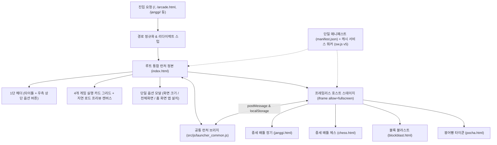
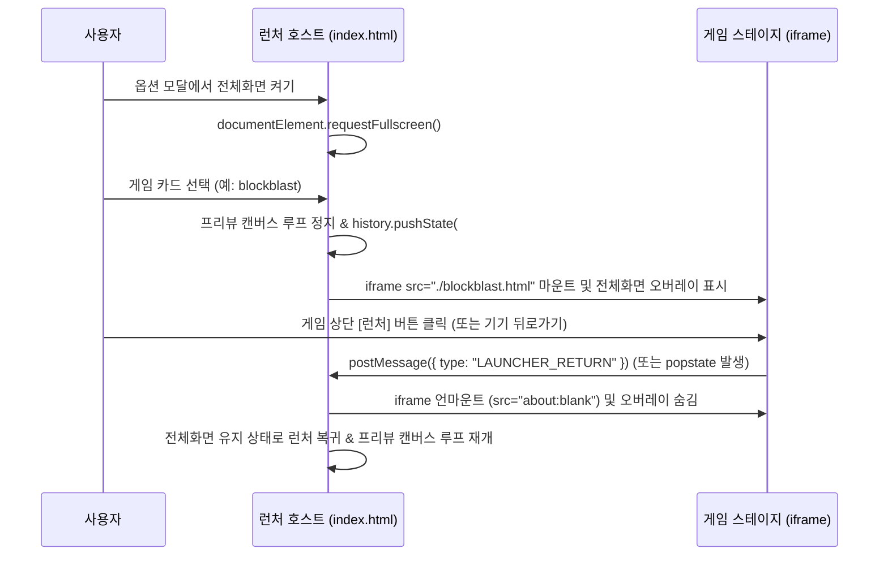

# 모바일 웹앱 통합 런처 구조 개편 (Unified Mobile WebApp Launcher Refactoring)

*   **Author:** et6065-ship-it
*   **Status:** Approved (Implemented with Goldfish Review Resolutions B-1..B-3, M-1..M-5, N-1..N-3)
*   **Date:** 2026-11-10

--------------------------------------------------------------------------------

## Overview

본 문서는 4종의 웹 게임(중세 배틀 장기, 중세 배틀 체스, 블록 블라스트, 전설의 붕어빵 타이쿤)을 묶는 **모바일 웹앱 통합 런처**의 진입 구조, 메인 UI, 공통 화면·전체화면 제어, 단일 PWA(Progressive Web App) 패키징을 개편하기 위한 기술 설계 명세서이다.

개편의 핵심은 다음 네 가지다.
1. 기본 웹 주소(`/`, `index.html`)를 통합 런처의 유일한 정본으로 단일화하고, 레거시 경로(`arcade.html`, 서브폴더 경로)는 경량 리다이렉트 스텁으로 통합한다.
2. 런처 메인 화면에는 **타이틀과 우측 상단 단일 옵션 버튼(`⚙️`), 4개 게임 실행 카드**만 배치하고 죽은 토글·개발자 배지·배포 버튼을 전면 제거한다.
3. 단일 `⚙️` 옵션 모달 안에 **화면 크기 조절 · 전체화면 · 홈 화면 앱 설치** 3개 기능만 수납하고, 모든 게임에서 실제 동작과 안내 문구가 일치하도록 공통 뷰포트 여백 규약을 연결한다.
4. 런처 내 프레임리스 `<iframe allow="fullscreen">` 호스트 컨테이너에서 개별 게임을 실행하여, 각 게임의 HTML/CSS 독립성을 유지하면서도 게임 진입·복귀 전 과정에서 전체화면 세션이 끊기지 않도록 한다.

## The Problem

### 현재 상태와 한계
1. **진입점 이원화 및 배포 산출물 6중 복제:** 현재 루트 [index.html](../../index.html)은 [janggi.html](../../janggi.html)의 동일 복제본(42,101 바이트)이며 실제 런처는 [arcade.html](../../arcade.html)에 분리되어 있다. 그 결과 기본 사이트 주소(`/`)로 접속하면 런처 대신 장기가 바로 실행된다. 또한 배포 워크플로([deploy_webapp.yml](../../.github/workflows/deploy_webapp.yml))는 `src/`와 `assets/` 전체를 6개 디렉토리에 중복 복사하면서도 정작 `/janggi/` 경로에는 `janggi.html` 덮어쓰기 규칙을 누락하고 있다.
2. **메인 화면 옵션 과밀 및 무효·취약 코드 잔존:** [arcade.html](../../arcade.html) 상단에는 이미 상시 노출된 타이쿤 카드를 숨기려다 무효화된 토글 버튼(`#btn-toggle-hidden-games`), 로컬 PC 서버 전용 경로 배지 및 GitHub 배포 버튼(`#btn-launcher-git-push`), 상단 인앱 배너가 한꺼번에 노출되어 모바일 첫 화면을 가린다. 아울러 로컬 런처 서버([desktop_launcher.py](../../desktop_launcher.py))에는 UI에서 쓰이지 않는 원격 실행 엔드포인트(`/api/git-push`, `/api/launch-pocha`)가 와일드카드 CORS(`Access-Control-Allow-Origin: *`) 상태로 열려 있어 외부 웹페이지 경유 요청에 취약하다.
3. **가짜 전역 화면 크기 설정과 전체화면 해제 모순:** 런처의 `화면 크기 조절`은 모든 게임에 자동 적용된다고 안내하지만 실제로는 [blockblast.html](../../blockblast.html) 단 하나만 설정값을 읽고 나머지 3개 게임([janggi.html](../../janggi.html), [chess.html](../../chess.html), [pocha.html](../../pocha.html))은 무시한다. 또한 일반 링크 이동(MPA) 구조 때문에 런처에서 `전체화면`을 켜더라도 게임 카드를 누르는 즉시 브라우저 보안 정책에 의해 전체화면이 해제되며, Fullscreen API를 지원하지 않는 iPhone Safari에서도 거짓 성공 토스트가 출력된다.
4. **PWA 매니페스트 파편화, 오프라인 크래시, 초기 로딩 지연:** [manifest.json](../../manifest.json)에는 4번째 게임인 `pocha.html`이 빠져 있고 [manifest-blockblast.json](../../manifest-blockblast.json)과 루트 스코프(`"./"`)가 겹친다. [sw.js](../../sw.js)는 캐시 조회(`caches.match`)만 있고 캐시 저장(`cache.put`) 코드가 없어 오프라인 실행 시 오류로 중단된다. 또한 런처가 작은 썸네일 2개를 그리기 위해 1.52MB 크기의 [hd_sprite_atlas.js](../../src/js/hd_sprite_atlas.js)와 [art_renderer.js](../../src/js/art_renderer.js)를 동기 로드하여 초기 화면 표시를 가로막고 있다.

### 새로운 접근과 기대 효과
* 루트 `index.html` 단일 정본과 경로 인식 리다이렉트 스텁을 결합해 파일 중복 관리 비용을 없애고 배포 아티팩트 중복을 6벌에서 1벌로 줄인다.
* 런처 호스트가 전체화면을 보유한 채 `<iframe allow="fullscreen">` 오버레이에 게임을 마운트함으로써, 4개 게임을 한 문서로 합치는 대규모 리팩터링 없이 전체화면 영속성을 달성한다.
* 도트 번짐이나 터치 좌표 왜곡이 없는 CSS 여백·가용 높이 변수를 통해 4개 게임 전체가 상·하단 브라우저 바 유무에 맞춰 일관되게 조정된다.

### 자원 비용 및 검증 기준 (Metrics & Exams)
* **구현·운영 비용:** 외부 유료 서비스나 신규 서드파티 라이브러리 추가 없이 기존 정적 웹 호스팅(GitHub Pages)과 표준 브라우저 API만으로 구현된다.
* **정량 검증 기준:**
  * 런처 초기 동기 로드 스크립트 용량: 기존 약 1.68MB → **100KB 미만** (`hd_sprite_atlas.js`, `art_renderer.js` 비동기 지연 로드 분리).
  * 배포 번들 에셋 복제 횟수: 기존 6회(`build/web` 및 5개 하위 폴더) → **루트 1회**로 축소.
  * 경로 도달 정합성: `/`, `/arcade.html`, `/arcade/`, `/janggi/`, `/chess/`, `/blockblast/`, `/pocha/` 및 `?game=janggi|chess` 진입 시 무한 리다이렉트 0건, 의도된 대상 화면 도달률 100%.
  * 오프라인 재실행 검증: 1회 온라인 로드 후 네트워크 차단 상태에서 런처 및 4개 게임 로드 시 `TypeError` 없이 캐시 응답 반환.

## Goals

* 루트 `index.html`을 모바일 웹앱 통합 런처의 유일한 정본으로 전환하고 `janggi.html` 중복 복제본을 제거한다.
* 기존 `arcade.html` 링크, 기설치 홈 화면 앱, GitHub Pages 서브경로(`/janggi/`, `/chess/`, `/blockblast/`, `/pocha/`, `/arcade/`), `desktop_launcher.py` CLI 인자(`--janggi`, `--chess`, `--pocha`)가 루프나 404 없이 동작하도록 호환성을 보장한다.
* 런처 메인 화면을 **1단 헤더(타이틀 + 우측 상단 `⚙️` 옵션 버튼) + 4개 게임 실행 카드 그리드**로 구성하고, 숨김 프로젝트 토글·워크스페이스 배지·GitHub 배포 버튼·상단 인앱 배너 및 미사용 로컬 서버 API를 제거한다.
* 런처에서 게임 카드 선택 시 프레임리스 `<iframe allow="fullscreen">` 스테이지에 게임을 로드하고 `postMessage` 및 브라우저 뒤로가기(`popstate`)로 복귀하여 전체화면 세션을 끊김 없이 유지한다.
* 단일 `⚙️` 옵션 모달 내에 ① 4개 게임 공통 `화면 크기 조절`(`최대 / 보통 / 축소`), ② 브라우저 지원 여부 및 전용앱 실행 상태를 판별하는 `전체화면`, ③ 실행 환경별 단일 액션을 제시하는 `홈 화면 앱 설치` 3개 기능만 수납한다.
* `manifest-blockblast.json`을 제거하고 `manifest.json`(기존 `id` 유지, `start_url: "./"`, 4개 게임 `shortcuts` 수록) 및 캐시 저장이 정상 작동하는 `sw.js`(`v5`)로 일원화한다.

## Non-Goals

* 붕어빵 타이쿤(`pocha.html`) 내부 게임플레이 루프, 밸런스, 스토리, 조리 조작계의 전면 재설계 (본 런처 개편 완료 후 2차 독립 EGM 사이클에서 수행).
* 중세 배틀 장기, 중세 배틀 체스, 블록 블라스트의 게임 규칙, AI 탐색 로직, 그래픽·사운드 에셋 변경.
* `janggi.html`과 `chess.html` 두 게임 본체 HTML 마크업의 단일 문서 병합.

## Open Questions

* 없음 (브레인스토밍 단계에서 진입점 단일화, `<iframe allow="fullscreen">` 호스트 컨테이너 채택, `manifest.json` 일원화 등 모든 아키텍처 의사결정 완료).

## Critical User Journeys (CUJs)

### CUJ 1: 대표 주소 및 레거시 서브경로 진입·복귀
* **Given:** 사용자가 모바일 브라우저 또는 기존 북마크를 통해 루트(`/`), 레거시 런처 주소(`/arcade.html`, `/arcade/`), 또는 개별 게임 서브경로(`/janggi/`, `/blockblast/`)로 접속한다.
* **When:** 페이지가 로드되거나 게임 상단의 `[🎮 런처]` 버튼을 누른다.
* **Then:** `/` 및 `/arcade.html`, `/arcade/`는 단일 런처 화면(4개 게임 카드 + 우측 상단 `⚙️` 버튼)을 즉시 표시하고, 서브경로 진입 후 `[🎮 런처]`를 누르더라도 자기 자신에게 갇히지 않고 루트 런처로 복귀한다.

### CUJ 2: 전체화면 활성화 후 무중단 게임 전환 및 뒤로가기 복귀
* **Given:** Fullscreen API를 지원하는 모바일/PC 브라우저에서 사용자가 런처 우측 상단 `⚙️` 모달을 연다. (단, iPhone Safari 등 미지원 환경에서는 거짓 성공 토스트 대신 `홈 화면 앱 설치` 안내가 표시되고, 이미 전용앱 실행 중이면 `"전용앱 전체화면 실행 중"` 상태가 표시된다.)
* **When:** 사용자가 `전체화면`을 켜고 모달을 닫은 뒤 원하는 게임 카드를 탭해 플레이하다가 상단 `[🎮 런처]` 버튼 또는 기기 물리 '뒤로가기' 버튼을 누른다.
* **Then:** 게임이 프레임리스 `<iframe>` 스테이지에 마운트되어 진입과 복귀 전 과정에서 전체화면이 해제되지 않으며, 게임 플레이 중 뒤쪽 런처의 프리뷰 캔버스 루프는 일시정지되었다가 복귀 시 재개된다.

### CUJ 3: 단일 옵션 모달에서 4개 게임 공통 화면 크기 조절
* **Given:** 인앱 브라우저 하단바 또는 기기 화면 비율 때문에 게임 하단 조작부가 좁게 느껴지는 상태다.
* **When:** 사용자가 런처 `⚙️` 모달에서 `화면 크기 조절`을 `보통` 또는 `축소`로 변경한 뒤 장기·체스·블록 블라스트·붕어빵 타이쿤 중 어느 게임을 실행한다.
* **Then:** 4개 게임 모두 도트 흐림이나 터치 좌표 어긋남 없이 지정된 하단 안전 여백과 보드 가용 높이 비율이 즉시 반영된다.

### CUJ 4: 환경별 홈 화면 전용앱 설치 및 오프라인 재실행
* **Given:** 사용자가 모바일 브라우저(Android Chrome, 카카오톡·네이버 인앱 브라우저, iOS Safari)에서 런처 `⚙️` 모달의 `홈 화면 앱 설치` 항목을 확인한다.
* **When:** 환경에 맞게 노출된 단일 설치 액션(원터치 설치 프롬프트, 외부 브라우저 열기, 또는 iOS 공유 메뉴 안내)으로 홈 화면에 앱을 추가한 뒤 네트워크가 끊긴 상태에서 앱 아이콘을 실행한다.
* **Then:** 상·하단 브라우저 바 없는 독립 전체화면 웹앱(`manifest.json`)으로 런처가 열리며, 서비스 워커(`sw.js`)에 저장된 캐시를 통해 런처와 이전에 방문한 게임이 네트워크 오류 없이 구동된다.

--------------------------------------------------------------------------------

## Technical Plan (Architecture)

### 1. 컴포넌트 경계 및 시스템 구조

기존에 단일 HTML 파일 내부에 뒤섞여 있던 런처 마크업·스타일·스크립트·로컬 서버 호출 코드를 분리하여, **순수 정적 웹앱 호스트 셸**과 **공통 뷰포트·런처 브리지 모듈** 중심으로 재구성한다.

*   **통합 런처 호스트 (`index.html`, `src/css/launcher.css`, `src/js/launcher.js`):**
    *   장기·체스 보드 전용 스타일시트([style.css](../../src/css/style.css))에 대한 의존성을 끊고 런처 전용 스타일시트(`launcher.css`)를 사용하여 전역 리셋 충돌을 차단한다.
    *   상단은 단일 `<header>` 안에 `<h1>` 타이틀과 우측 상단 `⚙️` 옵션 버튼(`aria-haspopup="dialog"`)만 1단으로 배치하고, 본문 `<main>`에는 4개 게임 카드(`<h2>`)를 배치한다.
    *   대용량 스프라이트 스크립트(`hd_sprite_atlas.js`, `art_renderer.js`)는 `defer`로 비동기 로드하여 초기 화면 표시를 막지 않으며, 스프라이트 로드 전에도 카드 레이아웃과 캔버스 플레이스홀더가 즉시 렌더링된다.
*   **공통 브리지 및 뷰포트 어댑터 (`src/js/launcher_common.js`):**
    *   런처와 4개 게임 HTML이 공통으로 로드하는 경량 스크립트다.
    *   화면 크기 설정값 동기화, `<iframe>` 호스트-게임 간 복귀 메시지(`postMessage`) 브리지, 서비스 워커 등록을 한곳에서 담당한다.

### 2. 진입점 단일화 및 무루프 라우팅 계약

파일 중복(`index.html == janggi.html` 또는 `index.html == arcade.html`)과 서브경로 무한 루프를 동시에 제거하기 위해 다음 라우팅 표를 적용한다.

| 진입 경로 | 역할 및 처리 방식 | 최종 도달 대상 |
| :--- | :--- | :--- |
| `/` (`index.html`) | 통합 런처 유일 정본 (쿼리 `?game=janggi\|chess` 감지 시 해당 게임 HTML로 즉시 치환 이동) | 통합 런처 홈 (또는 지정 게임) |
| `/arcade.html` | UI 없는 무상태 리다이렉트 스텁 (`location.pathname`이 하위 게임/아케이드 폴더면 `../`, 루트면 `./`로 `location.replace`) | `/` 통합 런처 홈 |
| `/janggi.html`, `/chess.html`, `/blockblast.html`, `/pocha.html` | 각 게임의 단일 정본 문서 (런처 내 `<iframe>` 마운트 및 단독 URL 직접 진입 모두 지원) | 각 개별 게임 |
| `/janggi/`, `/chess/`, `/blockblast/`, `/pocha/`, `/arcade/` | GitHub Pages 하위 경로 호환용 경량 리다이렉트 스텁 (`../janggi.html` 등 루트 정본으로 포워딩, 에셋 중복 복사 제거) | 루트 정본 문서 |

### 3. `<iframe allow="fullscreen">` 게임 스테이지 및 생명주기

런처에서 켠 전체화면이 게임 진입·복귀 시 해제되지 않도록 최상위 문서를 `index.html`로 유지한 채 오버레이 스테이지를 운용한다.

*   **복귀 이중 안전망:** 각 게임의 `[🎮 런처]` 링크 클릭 시 `launcher_common.js`가 `window.parent !== window` 여부를 확인한다. 호스트 `<iframe>` 내부에서 실행 중이면 기본 링크 이동을 막고 `parent.postMessage({ type: 'LAUNCHER_RETURN' }, window.location.origin)`(로컬 `file://` 테스트 시에만 `'*'` 허용하되 수신 측 출처 검증 수행)을 전송하며, 단독 URL로 직접 열린 상태라면 `./`로 이동한다.
*   **모바일 뒤로가기 연동:** 게임 마운트 시 `history.pushState({ launcherStage: gameId }, '', '#play-' + gameId)`를 기록한다. 사용자가 안드로이드 물리 뒤로가기 제스처를 입력하면 `popstate` 이벤트가 앱 종료 대신 스테이지를 닫고 런처 홈으로 복귀시킨다.
*   **GPU·배터리 절전 제어:** `<iframe>` 게임 스테이지가 열려 있거나, `⚙️` 옵션 모달이 열려 있거나, 브라우저 탭이 백그라운드(`document.hidden`)일 때는 런처의 4개 프리뷰 캔버스 루프를 완전히 중단한다. 활성 상태에서도 도트 애니메이션 스텝 주기(약 110ms)에만 캔버스를 다시 그린다.

### 4. 단일 `⚙️` 옵션 모달의 3대 상태 계약

옵션 모달(`role="dialog"`, `aria-modal="true"`, `Escape` 및 배경 터치 닫기 지원)은 정확히 아래 3개 섹션(`<h3>`)과 하단 1줄 읽기 전용 진단 요약(버전·실행모드·현재 Fit 단계)만 포함한다.

1.  **화면 크기 조절 (4개 게임 공통 뷰포트 여백 규약)**
    *   **스토리지 키:** 기존 사용자 설정 유실을 막기 위해 `BLOCK_BLAST_FIT_MODE_V1` 키(`'0' | '1' | '2'`)를 하위 호환 표준으로 유지한다. 수동 저장값이 없는 최초 접속 시에는 인앱 브라우저(`NAVER|KAKAOTALK|Instagram|FBAN|FBAV|Line`) 감지 시 기본값 `'1'(보통)`, 그 외 환경에서는 `'0'(최대)`을 선택한다.
    *   **전달 메커니즘:** CSS `transform: scale()`은 도트 번짐과 캔버스 터치 좌표 오차를 일으키므로 사용하지 않는다. 대신 `launcher_common.js`가 루트 및 각 게임의 `<html data-fit-mode="0|1|2">` 속성과 두 개의 의미론적 CSS 변수를 주입하고, `pageshow`(`bfcache` 복원), `storage`, 호스트 `postMessage({ type: 'LAUNCHER_FIT_CHANGE', mode })` 수신 시 즉시 갱신한다.
        *   `0 (최대 — 전용앱·전체화면 기본)`: `--app-fit-bottom-reserve: 12px`, `--app-board-max-dvh: 62dvh`
        *   `1 (보통 — 모바일 브라우저 하단바 여유)`: `--app-fit-bottom-reserve: 64px`, `--app-board-max-dvh: 54dvh`
        *   `2 (축소 — 하단 여유 최대 확보)`: `--app-fit-bottom-reserve: 108px`, `--app-board-max-dvh: 46dvh`
    *   **게임별 소비 방식:**
        *   장기·체스: `src/css/style.css` 모바일 구간의 고정 `48dvh !important` 및 하단 `105px` 패딩을 `var(--app-board-max-dvh)`와 `var(--app-fit-bottom-reserve)` 기반으로 치환한다(데스크톱 환경의 기존 [main.js](../../src/js/main.js) `medieval_janggi_settings_v2` 보드 배율 설정은 그대로 보존).
        *   블록 블라스트: `fitBoardToViewport()`가 동일한 하단 예약 여백 수치를 참조해 캔버스 크기를 재계산한다.
        *   붕어빵 타이쿤: 가로 폭은 유지한 채 `.portrait-viewport` 하단 안전 패딩과 `.core-9x16-stage` 높이를 `calc(100dvh - var(--app-fit-bottom-reserve))`로 조정한 뒤 주물틀 `resizeCanvas()`를 재호출한다.
2.  **전체화면 (3단계 런타임 지원성 상태 머신)**
    *   `STANDALONE_ACTIVE` (`matchMedia('(display-mode: standalone), (display-mode: fullscreen)').matches || navigator.standalone === true`): 이미 주소창 없는 전용앱으로 실행 중이므로 버튼을 비활성 상태 배지(`"전용앱 전체화면 실행 중"`)로 표시한다.
    *   `API_SUPPORTED` (`Boolean(document.fullscreenEnabled || document.webkitFullscreenEnabled)`): 실제 `requestFullscreen()` / `exitFullscreen()` Promise가 완료된 뒤에만 상태를 갱신하고 `fullscreenchange` / `webkitfullscreenchange` 이벤트로 라벨을 동기화한다(실패 시 거짓 성공 토스트 출력 금지).
    *   `API_UNSUPPORTED` (iPhone Safari 일반 탭, 제한된 인앱 WebView 등): 전체화면 토글을 비활성화하고 바로 아래 `홈 화면 앱 설치` 항목을 통해 전체화면 전용앱으로 실행할 수 있음을 안내한다.
3.  **홈 화면 앱 설치 (4단계 환경 적응형 단일 액션)**
    *   기존의 5개 페이지별 개별 주소 복사 목록을 제거하고 현재 브라우저 환경에 맞는 단일 액션만 노출한다.
    *   `INSTALLED` (Standalone 실행 중): `"홈 화면 앱으로 실행 중"` 완료 상태 표시.
    *   `PROMPT_READY` (`beforeinstallprompt` 캡처됨): 원터치 `[홈 화면에 앱 설치]` 실행 버튼 노출.
    *   `INAPP_WEBVIEW` (카카오톡·네이버 등 인앱 브라우저): 안드로이드는 외부 브라우저 전환(`kakaotalk://web/openExternal` 또는 `intent://`), iOS 인앱은 기본 Safari로 열기 안내 및 현재 루트 주소 복사 버튼 1개 노출.
    *   `MANUAL_GUIDE` (iOS Safari 등 수동 추가 환경): `"하단 공유(↑) → 홈 화면에 추가"` 2줄 안내 노출.

### 5. 단일 PWA 매니페스트 및 서비스 워커 캐시 구조

*   **매니페스트 일원화 (`manifest.json`):** `manifest-blockblast.json`을 삭제하고 모든 페이지가 `manifest.json` 하나만 참조한다. 기존 안드로이드 설치 사용자의 앱 업데이트 연속성을 위해 `"id": "pocha-tycoon-arcade-launcher"`는 절대 변경하지 않으며, `"start_url": "./"`, `"scope": "./"`, `"orientation": "any"`(폴더블·태블릿 가로 대국 호환), 4개 게임 전체 `shortcuts`(장기·체스·블록 블라스트·붕어빵 타이쿤)로 구성을 통일한다.
*   **오프라인 안전 캐싱 (`sw.js`):** 캐시 이름을 `game-launcher-pwa-v5`로 갱신한다. 동일 출처 `GET` 정적 요청에 대해 네트워크 응답이 정상(`response.ok`)일 때 복제본을 `caches.open(CACHE_NAME)`에 저장(`cache.put`)하고, 네트워크 단절 시 저장된 캐시를 반환하되 캐시 미스 시에는 `undefined` 대신 명시적 오프라인 안내 `Response`(상태 코드 `503`)를 반환하여 런타임 크래시를 차단한다.

--------------------------------------------------------------------------------

## Alternatives Considered

### Alternative A: 기존 페이지 이동(MPA) 유지 + 게임 진입 첫 터치 시 전체화면 복원
*   **Pros:** `<iframe>` 오버레이와 `postMessage`·`popstate` 연동 없이 기존 `<a href>` 링크 구조를 그대로 유지할 수 있다.
*   **Cons:** 브라우저 보안 정책상 카드를 탭해 다른 HTML로 이동하는 즉시 전체화면이 강제 해제되며, 다음 페이지의 첫 터치 전까지 상·하단 주소창이 반복 노출되는 깜빡임이 발생한다.
*   **Reason for Rejection:** *Rejected by author:* 런처에서 활성화한 전체화면 세션이 게임 전환과 복귀 내내 끊기지 않도록 `<iframe allow="fullscreen">` 호스트 스테이지 구조를 채택함.

### Alternative B: 런처 옵션 모달에서 `전체화면` 항목 제거 (홈 화면 앱 설치로 일원화)
*   **Pros:** 브라우저별 Fullscreen API 지원 편차(iOS Safari 미지원 등) 관련 상태 분기 코드를 없앨 수 있다.
*   **Cons:** 홈 화면에 앱을 별도 설치하지 않고 모바일·태블릿·PC 일반 브라우저 탭에서 즉시 전체화면으로 플레이하려는 사용자의 진입 수단이 사라진다.
*   **Reason for Rejection:** *Rejected by author:* 단일 옵션 모달의 3대 핵심 기능(`화면 크기 조절 · 전체화면 · 홈 화면 앱 설치`)을 모두 유지하되 지원성 판별로 오동작만 차단하기로 결정함.

### Alternative C: 루트(`/`, `index.html`)를 장기로 유지하고 `./arcade.html`만 런처로 유지
*   **Pros:** 과거 루트 URL을 장기 직행 북마크로 저장해 둔 사용자가 추가 탭 없이 장기로 진입한다.
*   **Cons:** 기본 도메인 주소 공유 시 통합 런처 대신 특정 단일 게임(장기)만 열리고, `index.html`과 `janggi.html` 700줄 중복 관리 문제가 그대로 남는다.
*   **Reason for Rejection:** *Rejected by author:* 대표 진입 주소를 통합 런처 본체(`index.html`)로 단일화하고 장기는 `janggi.html` 단일 파일로 일원화하기로 결정함.

### Alternative D: `index.html`과 `arcade.html` 양쪽에 런처 전체 마크업·스크립트 복제 유지
*   **Pros:** 리다이렉트 1홉 없이 두 주소 모두 런처를 직접 렌더링한다.
*   **Cons:** 기존 `index.html == janggi.html` 코드 중복 부채가 `index.html == arcade.html` 중복 부채로 형태만 바뀌어 유지보수 시 한쪽만 수정되는 불일치 위험이 재발한다.
*   **Reason for Rejection:** *기술적 사유로 기각:* 단일 정본 원칙(SSOT)을 지키기 위해 런처 코드는 `index.html` 한 곳에만 두고 `arcade.html`은 UI 없는 경량 리다이렉트 스텁으로 축소함.

### Alternative E: CSS `transform: scale()`을 이용한 4개 게임 일괄 화면 축소
*   **Pros:** 각 게임의 레이아웃 CSS를 수정하지 않고 바깥 컨테이너에 배율만 곱하면 구현 코드가 짧다.
*   **Cons:** 도트 픽셀 아트가 소수점 배율 보간으로 흐려지고, 캔버스(`janggi`, `chess`, `blockblast`, `pocha`)의 `getBoundingClientRect` 기반 터치·드래그 좌표 계산에 오차가 생길 위험이 크다.
*   **Reason for Rejection:** *기술적 사유로 기각:* 픽셀 선명도와 터치 정확도를 보존하기 위해 의미론적 CSS 여백·높이 변수(`--app-fit-bottom-reserve`, `--app-board-max-dvh`) 전달 방식을 채택함.

### Alternative F: 블록 블라스트 전용 매니페스트(`manifest-blockblast.json`) 병행 유지
*   **Pros:** 블록 블라스트 페이지에서 직접 설치할 때 별도 아이콘 이름을 부여할 수 있다.
*   **Cons:** 동일한 `"scope": "./"`를 공유하는 두 매니페스트가 충돌하여 안드로이드 WebAPK 캡처 동작이 설치 순서에 따라 달라진다.
*   **Reason for Rejection:** *Rejected by author:* `manifest-blockblast.json`을 폐기하고 4개 게임을 단일 통합 런처 매니페스트(`manifest.json`)와 `shortcuts` 아래 일원화하기로 결정함.

### Alternative G: 런처 구조 개편과 붕어빵 타이쿤 전면 재설계를 단일 스펙으로 일괄 진행
*   **Pros:** 설계 문서를 한 번만 작성한다.
*   **Cons:** 가벼운 런처 개편 배포가 2,202줄 규모의 타이쿤 게임 메커니즘 재설계 일정에 묶이고, 리뷰 초점이 분산된다.
*   **Reason for Rejection:** *Rejected by author:* 1차 사이클에서 런처 구조 개편과 공통 셸 계약을 먼저 완료한 뒤, 2차 사이클에서 붕어빵 타이쿤 전면 재설계를 독립 진행하기로 결정함.

--------------------------------------------------------------------------------

## Non-Functional Requirements

### 1. 보안 (Security & Privacy)
*   **로컬 서버 CSRF 표면 제거:** `desktop_launcher.py`에서 인증 없이 열려 있던 `POST /api/git-push`, `POST /api/launch-pocha`, `GET /api/status` 엔드포인트와 `Access-Control-Allow-Origin: *` 응답 헤더를 제거하여 외부 사이트 경유 로컬 명령 실행 가능성을 원천 차단한다.
*   **`postMessage` 출처 검증:** 런처 호스트(`index.html`)와 `<iframe>` 게임 스테이지 간 메시지 수신 시 동일 출처(`event.origin === window.location.origin`, 로컬 파일 프로토콜 예외 시 `event.source === stageFrame.contentWindow` 교차 확인)만 허용한다.

### 2. 성능 및 자원 예산 (Performance & Resource Budget)
*   **초기 렌더링 블로킹 해소:** 1.52MB 크기의 `src/js/hd_sprite_atlas.js`와 124KB 크기의 `src/js/art_renderer.js`는 `defer` 속성으로 분리하여 런처 첫 화면 HTML+CSS+핵심 JS 동기 로드 용량을 100KB 미만으로 유지한다.
*   **이중 GPU 점유 차단:** `<iframe>` 안에서 게임이 실행되는 동안 뒤쪽 런처의 4개 프리뷰 캔버스 애니메이션 루프는 즉시 정지(`cancelAnimationFrame`)시켜 모바일 발열과 프레임 저하를 막는다.

### 3. 배포 호환성 및 롤백 (Rollout & Rollback)
*   **기설치 PWA 연속성:** `manifest.json`의 `"id": "pocha-tycoon-arcade-launcher"`를 불변 유지하여 기존 안드로이드 홈 화면 설치 앱이 중복 아이콘 생성 없이 자동 업데이트되도록 한다. iOS 기설치 홈 화면 북마크(`./arcade.html`)는 리다이렉트 스텁을 통해 Standalone 창 안에서 끊김 없이 `/` 런처로 연결된다.
*   **롤백 절차:** 단일 정적 웹 배포 구조이므로 문제 발생 시 직전 Git 커밋을 `main` 브랜치에 되돌리기(`git revert`)하면 GitHub Actions(`deploy_webapp.yml`)가 기존 정적 번들을 즉시 재배포하며, `sw.js`는 Network-first 전략이므로 다음 온라인 접속 즉시 구버전 문서를 복구한다.

### 4. 주요 리스크 및 완화책 (Risks & Mitigations)
*   **`iframe` 내부 세로 소형 화면에서의 타이쿤 높이 압박:** 화면 세로 높이가 600px 미만인 기기에서 `축소(2)` 모드(`--app-fit-bottom-reserve: 108px`)를 적용할 경우 `pocha.html`의 주물틀 영역이 지나치게 좁아질 수 있으므로, `pocha.html`의 스테이지 최소 가용 높이에 하한선(`max(420px, 100dvh - var(--app-fit-bottom-reserve))`)을 두어 조리 슬롯 터치 영역 붕괴를 방지한다.
*   **스토리지 차단 환경(사생활 보호 모드 등):** 모든 `localStorage` 읽기·쓰기는 예외 안전 래퍼로 감싸고 차단 시 메모리 내 세션 상태와 `postMessage`로 동일하게 동작하도록 폴백한다.

--------------------------------------------------------------------------------

## Detailed Implementation Plan

### 구현 단계 구분 (Phasing & Checkpoints)

각 단계 종료 시점에 프로젝트가 깨지지 않고 실행·검증 가능한 상태를 유지하도록 4단계로 나누어 수행한다.
*   **Phase 1 (공통 브리지·PWA·서비스 워커 기반 구축):** `src/js/launcher_common.js` 신설, `manifest.json` 통합 갱신, `manifest-blockblast.json` 삭제, `sw.js` 오프라인 캐싱 보강.
*   **Phase 2 (4개 개별 게임 어댑터 연결):** `janggi.html`, `chess.html`, `src/css/style.css`, `blockblast.html`, `pocha.html`에 공통 브리지·매니페스트·뷰포트 변수·복귀 인터페이스를 연결.
*   **Phase 3 (루트 통합 런처 정본 전환 및 레거시 스텁화):** `src/css/launcher.css`, `src/js/launcher.js` 작성 후 `index.html`을 통합 런처 정본으로 교체하고 `arcade.html`을 경로 인식 리다이렉트 스텁으로 축소.
*   **Phase 4 (배포 파이프라인 및 로컬 런처 정리):** `.github/workflows/deploy_webapp.yml` 6중 복사 제거 및 서브경로 스텁 생성, `desktop_launcher.py` 경로 갱신·취약 API 제거, [깃허브_업로드.sh](../../깃허브_업로드.sh) 안내 주소 동기화.

---

### Target Scope & File Boundary (총 16개 파일)

아래 목록 외의 저장소 파일(개별 게임 규칙 스크립트, 에셋 이미지, Python 타이쿤 내부 소스 등)은 본 작업에서 수정하지 않는다.

#### 1. `src/js/launcher_common.js` (Create)
*   **Type / Scope:** 클라이언트 공통 JavaScript 브리지 모듈 (`window.LauncherCommon` 전역 네임스페이스 노출).
*   **Rationale:** 런처와 4개 게임 페이지에 중복 없이 화면 크기 토큰 주입, `<iframe>` 복귀 메시지 송수신, 서비스 워커 등록, 런타임 환경 판별 기능을 제공하기 위함이다.
*   **Proposed Changes:**
    *   상수 정의: `FIT_STORAGE_KEY = 'BLOCK_BLAST_FIT_MODE_V1'`, `APP_VERSION = 'v5'`, 하단 여백 테이블 `[12, 64, 108]`(단위 `px`), 보드 최대 높이 테이블 `['62dvh', '54dvh', '46dvh']`.
    *   `readFitMode()` / `writeFitMode(mode)`: `localStorage` 예외 안전 읽기·쓰기를 수행한다. 저장된 값이 없으면 UA가 인앱 패턴(`NAVER|KAKAOTALK|Instagram|FBAN|FBAV|Line`)과 일치할 때 `1`, 그 외에는 `0`을 반환한다.
    *   `applyFitTokens(mode)`: 현재 문서의 `document.documentElement`에 `data-fit-mode` 속성(`'0'|'1'|'2'`)과 CSS 커스텀 프로퍼티 `--app-fit-bottom-reserve`, `--app-board-max-dvh`를 설정하고, 커스텀 DOM 이벤트 `launcher:fit-change` (`detail: { mode, bottomReservePx }`)를 발행한다.
    *   이벤트 바인딩: 초기 실행 시, `window`의 `pageshow` 이벤트(`bfcache` 복원 포함) 시, `storage` 이벤트 시, 그리고 부모 창으로부터 동일 출처 `postMessage` (`{ type: 'LAUNCHER_FIT_CHANGE', mode }`) 수신 시 `applyFitTokens`를 실행한다.
    *   `bindReturnLinks(selector)`: 게임 상단 복귀 요소 클릭 시 `window.parent !== window`이면 기본 이동을 막고 부모 창으로 `{ type: 'LAUNCHER_RETURN' }` 메시지를 전송하며(동일 출처 타깃, `file:` 프로토콜에서만 `'*'`), 단독 창이면 `./`로 이동한다. (장기·체스에서 진행 수 `moveCount > 0`이고 대국 미종료 상태일 때는 사용자 확인 대화상자를 거친 뒤 복귀 처리한다.)
    *   `detectEnvironment()`: `{ isStandalone, isIOS, isAndroid, isInApp, isKakao, fullscreenSupported }` 불리언 맵을 계산해 반환한다.
    *   `registerServiceWorker()`: `https:` 또는 `localhost`/`127.0.0.1` 환경에서 `./sw.js`를 등록한다.

#### 2. `src/css/launcher.css` (Create)
*   **Type / Scope:** 통합 런처 전용 스타일시트.
*   **Rationale:** 장기·체스 보드용 `src/css/style.css`의 전역 리셋 규칙(`* { border-radius: 0 !important; }` 등)과 분리하여 런처와 모달, `<iframe>` 스테이지 레이아웃을 독립 관리하기 위함이다.
*   **Proposed Changes:**
    *   1단 상단 헤더(`.launcher-header`: 좌측 타이틀 `<h1>`, 우측 고정 크기 `⚙️` 아이콘 버튼) 및 안전 영역 패딩(`env(safe-area-inset-top/bottom)`) 정의.
    *   4개 게임 카드 그리드(`.launcher-grid`): 모바일 세로 화면에서도 과도한 스크롤 없이 탐색 가능하도록 컴팩트 카드 비율을 적용하고 태블릿·데스크톱에서는 2×2 대칭 그리드로 배치한다.
    *   전체화면 게임 호스트 오버레이(`.launcher-stage-overlay` 및 `#game-stage-frame`): 고정 위치(`inset: 0`, `width: 100%`, `height: 100dvh`, `border: 0`, `z-index: 150`), 비활성 시 `display: none`.
    *   단일 `⚙️` 옵션 모달(`.launcher-modal-backdrop`, `.launcher-modal-dialog`): 3개 옵션 카드 섹션(`화면 크기 조절` 3단 라디오형 버튼 그룹, `전체화면` 상태 배지 및 토글 버튼, `홈 화면 앱 설치` 단일 액션 영역)과 최하단 1줄 진단 푸터 스타일 정의.

#### 3. `src/js/launcher.js` (Create)
*   **Type / Scope:** 통합 런처 호스트 컨트롤러 스크립트.
*   **Rationale:** 런처 인라인 스크립트(약 420줄)를 외부 모듈로 분리하고 `<iframe>` 스테이지 생명주기, 3종 옵션 모달 상태 머신, 절전형 프리뷰 캔버스 루프를 제어하기 위함이다.
*   **Proposed Changes:**
    *   **레거시 쿼리 포워딩:** 페이지 진입 시 URL 쿼리가 `?game=janggi`이면 `./janggi.html`로, `?game=chess`이면 `./chess.html`로 즉시 `location.replace`한다.
    *   **`<iframe allow="fullscreen">` 스테이지 관리 (`openGameStage(gameId, targetUrl)` / `closeGameStage(fromPopState)`):**
        *   카드 클릭 시 기본 링크 이동을 가로채(단, `Ctrl`/`Meta`/중클릭 새 탭 열기는 기본 동작 허용) 프리뷰 캔버스 루프를 즉시 중단하고 `#game-stage-frame`에 대상 URL을 마운트한 뒤 `history.pushState({ launcherStage: gameId }, '', '#play-' + gameId)`를 호출한다.
        *   스테이지 로드 완료 시 현재 `fitMode`를 `stageFrame.contentWindow.postMessage({ type: 'LAUNCHER_FIT_CHANGE', mode }, ...)`로 동기화한다.
        *   `window`의 `message` 이벤트에서 출처 검증(`event.origin === location.origin` 및 `event.source === stageFrame.contentWindow`) 통과 후 `type === 'LAUNCHER_RETURN'` 수신 시 스테이지를 닫고 `src = 'about:blank'`로 비운 뒤 히스토리를 정리하고 프리뷰 루프를 재개한다. `popstate` 발생 시에도 동일하게 스테이지를 닫는다.
    *   **단일 `⚙️` 옵션 모달 제어:**
        *   열기/닫기(`Escape` 키, 배경 클릭, 닫기 버튼) 시 포커스 복원 및 프리뷰 루프 일시정지/재개를 수행한다.
        *   섹션 1 (`화면 크기 조절`): `최대(0)` / `보통(1)` / `축소(2)` 선택 시 `LauncherCommon.writeFitMode(mode)`를 호출하고 활성 스테이지가 있으면 즉시 전파한다.
        *   섹션 2 (`전체화면`): `LauncherCommon.detectEnvironment()`를 바탕으로 `STANDALONE_ACTIVE` / `API_SUPPORTED` / `API_UNSUPPORTED` 3가지 상태를 렌더링하며, Promise 성공(`then`) 및 `fullscreenchange`/`webkitfullscreenchange` 이벤트에서만 활성 라벨을 바꾸고 거부(`catch`) 시 실패 안내 토스트를 표시한다.
        *   섹션 3 (`홈 화면 앱 설치`): `beforeinstallprompt` 캡처 여부에 따라 `INSTALLED` / `PROMPT_READY` / `INAPP_WEBVIEW`(카톡은 `kakaotalk://web/openExternal?url=...`, 안드로이드 일반 인앱은 외부 브라우저 `intent://`, iOS 인앱은 Safari 열기 안내 + 루트 URL 복사) / `MANUAL_GUIDE`(iOS Safari 공유 메뉴 안내) 중 현재 환경에 해당하는 단일 액션만 렌더링한다.
        *   하단 진단 푸터: `v5 · [Standalone|InApp|Browser] · Fit:[0|1|2] · FS:[On|Off|Unsupported]` 1줄 텍스트 표시.
    *   **절전형 4종 프리뷰 캔버스 루프:** 기존 `arcade.html`의 4개 프리뷰 드로잉 로직을 이관하되 `window.ArtRenderer`가 지연 로드되기 전에는 기본 도형 폴백을 그리고 로드 완료 후 도트 유닛을 렌더링한다. 110ms 스텝 주기가 경과했을 때만 재드로잉하며, `document.hidden`·모달 열림·게임 스테이지 열림 상태에서는 `requestAnimationFrame`을 예약하지 않는다.

#### 4. `index.html` (Modify)
*   **Type / Scope:** 루트 대표 진입 문서 (기존 장기 복제본을 통합 런처 정본으로 전면 교체).
*   **Rationale:** 기본 도메인(`/`) 접속 시 곧바로 통합 런처가 열리도록 진입점을 단일화하고 `janggi.html`과의 중복을 제거하기 위함이다.
*   **Proposed Changes:**
    *   `<head>`에 모바일 뷰포트(`viewport-fit=cover`), `./manifest.json`, 아이콘 링크, `./src/css/launcher.css`를 선언하고 타이틀을 4개 게임 통합 명칭으로 갱신한다.
    *   `<body>`는 1단 `<header>`(`<h1>` + 우측 상단 `#btn-launcher-options` `⚙️` 버튼), `<main>`(장기·체스·블록 블라스트·붕어빵 타이쿤 4개 카드 `<h2>`), 전체화면 `<iframe id="game-stage-frame" allow="fullscreen">` 스테이지 컨테이너, 단일 `#launcher-options-modal` 다이얼로그(`<h2>` 옵션 제목 및 3개 `<h3>` 섹션), 토스트 알림 요소만으로 구성한다.
    *   스크립트는 `./src/js/launcher_common.js`, `./src/js/launcher.js`를 로드하고, `./src/js/hd_sprite_atlas.js`와 `./src/js/art_renderer.js`는 `defer` 속성으로 비동기 로드한다.

#### 5. `arcade.html` (Modify)
*   **Type / Scope:** 레거시 런처 주소 호환용 무상태 리다이렉트 스텁.
*   **Rationale:** 런처 코드 중복을 없애면서 기존 북마크, 기설치 iOS 홈 화면 아이콘, 레거시 `./arcade.html` 링크가 서브경로 여부를 불문하고 루프 없이 루트 런처로 이동하게 하기 위함이다.
*   **Proposed Changes:**
    *   기존 998줄 UI·스크립트를 제거하고, 현재 `location.pathname`의 직전 디렉토리명이 `janggi`, `chess`, `blockblast`, `pocha`, `arcade` 중 하나이면 `'../'`로, 그 외(루트)이면 `'./'`로 쿼리·해시를 보존해 `location.replace`하는 경량 HTML 스텁(`meta refresh` 폴백 포함)으로 교체한다.

#### 6. `janggi.html` (Modify)
*   **Type / Scope:** 중세 배틀 장기 단일 정본 HTML.
*   **Rationale:** 공통 뷰포트 토큰·`<iframe>` 복귀 브리지·서비스 워커 등록을 연결하고 복귀 링크를 정규화하기 위함이다.
*   **Proposed Changes:**
    *   `<head>`에 누락된 `apple-touch-icon` 및 `192x192` 파비콘 링크를 보강하고 `./src/js/launcher_common.js`를 로드한다.
    *   상단 `#btn-go-launcher`의 `href`를 `"./"`로 변경하고 `data-launcher-return="true"` 및 `aria-label="통합 게임 런처로 이동"`을 부여한다.

#### 7. `chess.html` (Modify)
*   **Type / Scope:** 중세 배틀 체스 단일 정본 HTML.
*   **Rationale:** `janggi.html`과 대칭적으로 공통 브리지·아이콘·복귀 링크 규약을 일치시키기 위함이다.
*   **Proposed Changes:**
    *   `<head>`에 `apple-touch-icon` 및 파비콘 링크를 보강하고 `./src/js/launcher_common.js`를 로드한다.
    *   상단 `#btn-go-launcher`의 `href`를 `"./"`로 변경하고 `data-launcher-return="true"` 및 `aria-label="통합 게임 런처로 이동"`을 부여한다.

#### 8. `src/css/style.css` (Modify)
*   **Type / Scope:** 장기·체스 공용 스타일시트 (모바일 반응형 미디어쿼리 구간 한정 수정).
*   **Rationale:** 모바일에서 `48dvh !important`와 `105px` 고정 하단 패딩이 런처의 `화면 크기 조절` 변수를 가로막던 문제를 해소하기 위함이다.
*   **Proposed Changes:**
    *   `:root`에 기본 폴백 변수(`--app-fit-bottom-reserve: 12px`, `--app-board-max-dvh: 62dvh`)를 선언한다.
    *   모바일 세로 구간(`.workspace-grid` 하단 패딩)의 고정 `105px`를 `var(--app-fit-bottom-reserve, 64px)`와 `env(safe-area-inset-bottom, 0px)` 합산값으로 교체한다.
    *   모바일 및 소형 화면 미디어쿼리의 `#janggi-board-canvas` 폭 규칙을 `min(94vw, var(--app-board-max-dvh, 62dvh))` 기반으로 통일하여 `최대(0) / 보통(1) / 축소(2)` 변경이 모바일·소형폰 모두에서 즉각 반영되도록 한다(폴더블 펼침 구간 `580px~960px`에서도 `var(--app-board-max-dvh)` 연동).

#### 9. `blockblast.html` (Modify)
*   **Type / Scope:** 블록 블라스트 단일 정본 HTML.
*   **Rationale:** 단일 매니페스트 일원화, 죽은 DOM 리스너 제거, `<iframe>` 환경 및 `bfcache` 복원 시 화면 크기 재동기화를 보장하기 위함이다.
*   **Proposed Changes:**
    *   `<link rel="manifest">` 대상을 `./manifest-blockblast.json`에서 `./manifest.json`으로 변경하고 `./src/js/launcher_common.js`를 로드한다.
    *   상단 런처 복귀 링크의 `href`를 `"./"`로 바꾸고 `data-launcher-return="true"` 및 `aria-label="통합 게임 런처로 이동"`을 부여한다.
    *   가이드 모달 내부의 중복 PWA 설치 안내 블록과 DOM에 존재하지 않는 `#btn-bb-fit`, `#btn-bb-fullscreen` 고아 이벤트 리스너를 제거한다.
    *   `fitBoardToViewport()`가 `LauncherCommon.readFitMode()` 및 호스트 전체화면 여부(`document.fullscreenElement || (parent !== window && parent.document.fullscreenElement)` 예외 안전 확인)를 참조하도록 수정하고, `launcher:fit-change` 이벤트 수신 시 `fitBoardToViewport()`를 즉시 재호출한다.

#### 10. `pocha.html` (Modify)
*   **Type / Scope:** 전설의 붕어빵 타이쿤 HTML (1차 사이클에서는 셸 통합 및 뷰포트 여백 연동만 수행).
*   **Rationale:** 누락되어 있던 PWA 매니페스트·서비스 워커 연결과 4개 게임 공통 `화면 크기 조절` 여백 반영, 복귀 버튼 접근성 대칭화를 달성하기 위함이다.
*   **Proposed Changes:**
    *   `<head>`에 `./manifest.json`, 아이콘 링크, `./src/js/launcher_common.js`를 추가한다.
    *   상단 복귀 링크(`🎮`)를 `href="./"`, `data-launcher-return="true"`, `aria-label="통합 게임 런처로 이동"`, 텍스트·아이콘 표기(`🎮 런처`)로 통일한다.
    *   `.portrait-viewport` 하단 패딩 및 `#core-stage`(`.core-9x16-stage`) 높이가 `--app-fit-bottom-reserve`를 반영하되 최소 높이 하한선(`420px`)을 보장하도록 조정하고, `launcher:fit-change` 이벤트 수신 시 주물틀 `resizeCanvas()`를 재호출한다.

#### 11. `manifest.json` (Modify)
*   **Type / Scope:** 통합 웹앱 단일 PWA 매니페스트.
*   **Rationale:** 기존 설치 앱 식별자를 보존하면서 진입 경로를 루트로 갱신하고 4개 게임을 대칭 등록하기 위함이다.
*   **Proposed Changes:**
    *   `"id": "pocha-tycoon-arcade-launcher"`는 그대로 유지한다.
    *   `"start_url": "./"`, `"scope": "./"`, `"orientation": "any"`로 갱신하고, `"name"` 및 `"description"`에 4개 게임 전체를 명시하며 `"shortcuts"` 배열에 4번째 항목으로 `🐟 전설의 붕어빵 타이쿤 바로 실행` (`"url": "./pocha.html"`)을 추가한다.

#### 12. `manifest-blockblast.json` (Delete)
*   **Type / Scope:** 블록 블라스트 개별 매니페스트 파일 삭제.
*   **Rationale:** `manifest.json`과의 동일 `"scope": "./"` 충돌을 영구 제거하고 단일 통합 웹앱으로 일원화하기 위함이다.
*   **Proposed Changes:** 파일 삭제 및 참조처(`blockblast.html`, `.github/workflows/deploy_webapp.yml`) 정리.

#### 13. `sw.js` (Modify)
*   **Type / Scope:** PWA 서비스 워커 스크립트.
*   **Rationale:** 캐시 미저장 결함으로 인한 오프라인 실행 크래시를 수정하고 에셋 재방문 캐시를 활성화하기 위함이다.
*   **Proposed Changes:**
    *   `CACHE_NAME`을 `'game-launcher-pwa-v5'`로 변경한다.
    *   `fetch` 핸들러에서 동일 출처(`url.origin === self.location.origin`) `GET` 요청에 대해 네트워크 응답이 정상(`response && response.status === 200 && response.type === 'basic'`)이면 `response.clone()`을 `CACHE_NAME`에 비동기 `cache.put`한 뒤 반환한다.
    *   네트워크 실패 시 `caches.match(event.request)`를 조회하고, 캐시에도 없을 때는 `undefined` 대신 상태 코드 `503`과 한국어 오프라인 안내 텍스트를 담은 `new Response(...)` 객체를 반환한다.

#### 14. `.github/workflows/deploy_webapp.yml` (Modify)
*   **Type / Scope:** GitHub Pages 자동 배포 워크플로.
*   **Rationale:** `src/`·`assets/` 6중 복사를 제거해 배포 용량을 1/6로 줄이고, `/janggi/` 라우팅 누락 및 서브경로 리다이렉트 루프를 차단하기 위함이다.
*   **Proposed Changes:**
    *   루트 `build/web/`에만 `index.html`, `arcade.html`, `janggi.html`, `chess.html`, `blockblast.html`, `pocha.html`, `manifest.json`, `sw.js`, `src/`, `assets/` 1벌을 복사한다(삭제된 `manifest-blockblast.json` 복사 구문 제거).
    *   하위 호환 디렉토리 `build/web/arcade/`, `build/web/janggi/`, `build/web/chess/`, `build/web/blockblast/`, `build/web/pocha/`에는 에셋을 복사하지 않고, 각각 루트의 `../` 또는 `../<game>.html`로 쿼리·해시를 보존해 즉시 이동시키는 경량 `index.html` 및 `arcade.html` 리다이렉트 스텁만 생성한다.

#### 15. `desktop_launcher.py` (Modify)
*   **Type / Scope:** 로컬 PC 실행 보조 스크립트.
*   **Rationale:** 루트 진입점 단일화에 맞춰 CLI 경로를 갱신하고, 인증 없는 로컬 명령 실행 엔드포인트와 와일드카드 CORS 취약점을 제거하기 위함이다.
*   **Proposed Changes:**
    *   기본 `entry_page`를 `"index.html"`로, `--janggi` 인자 시 `"janggi.html"`로 변경한다(`--chess` → `"chess.html"`, `--pocha` 네이티브 실행 분기는 기존 유지).
    *   `UnifiedLauncherHTTPHandler`에서 미사용 `do_POST`(`/api/launch-pocha`, `/api/git-push`), `/api/status` 분기, `Access-Control-Allow-Origin: *` 헤더를 제거하여 순수 정적 파일 서빙 핸들러로 단순화하고, HTTP 4xx/5xx 오류 발생 시 콘솔 진단 로그가 출력되도록 복원한다.

#### 16. `깃허브_업로드.sh` (Modify)
*   **Type / Scope:** 배포 안내 셸 스크립트.
*   **Rationale:** 콘솔에 출력되는 접속 주소 안내가 개편된 진입 구조(`/` = 통합 런처)와 어긋나지 않도록 일치시키기 위함이다.
*   **Proposed Changes:** 배포 완료 에코 문구에서 메인 주소(`/`)를 `통합 게임 런처`로 표기하고 `/pocha/` 안내 줄을 추가한다.

---

### 검증 및 테스트 계획 (Verification & Test Plan)

구현 완료 후 로컬 정적 웹 서버 환경에서 다음 항목을 순서대로 검증한다.
1.  **라우팅 및 레거시 호환 검증:**
    *   `/`, `/index.html`, `/arcade.html`, `/arcade/` 접속 시 모두 무한 루프 없이 통합 런처가 렌더링되는지 확인한다.
    *   `/?game=janggi`, `/?game=chess`, `/janggi/`, `/chess/`, `/blockblast/`, `/pocha/` 접속 시 각각 의도된 개별 게임으로 정확히 이동하는지 확인한다.
2.  **메인 UI 정밀도 및 초기 로딩 검증:**
    *   런처 첫 화면에 1단 헤더(타이틀 + `⚙️` 버튼)와 4개 게임 카드만 존재하고, 숨김 토글·워크스페이스 배지·GitHub 배포 버튼·인앱 배너가 DOM에 존재하지 않음을 확인한다.
    *   네트워크 탭에서 초기 문서 차단 스크립트에서 `hd_sprite_atlas.js`(1.52MB)가 `defer`로 분리되어 런처 UI가 지연 없이 먼저 표시되는지 확인한다.
3.  **`<iframe allow="fullscreen">` 스테이지 및 뒤로가기 검증:**
    *   `⚙️` 모달에서 `전체화면` 활성화(지원 브라우저) → 게임 카드 클릭 → 게임 상단 `[🎮 런처]` 클릭 및 브라우저 뒤로가기(`popstate`) 실행 시 전체화면이 풀리지 않고 런처로 복귀하는지 확인한다.
    *   게임 스테이지가 열린 동안 런처 배경 프리뷰 `requestAnimationFrame` 루프가 정지 상태인지 확인한다.
4.  **4개 게임 공통 `화면 크기 조절` 반영 검증:**
    *   `⚙️` 모달에서 `최대(0)` → `보통(1)` → `축소(2)` 전환 시 장기·체스·블록 블라스트·붕어빵 타이쿤 4개 게임 모두에서 `<html data-fit-mode>` 및 하단 여백·보드 가용 높이가 즉시 변경되고, 세로 568px 소형 뷰포트에서도 `pocha.html` 조리 캔버스가 최소 높이(`420px`) 이상을 유지하는지 확인한다.
5.  **PWA 매니페스트 및 오프라인 서비스 워커 검증:**
    *   5개 HTML 문서가 모두 단일 `./manifest.json`(`id: "pocha-tycoon-arcade-launcher"`, 4개 `shortcuts`)을 가리키고 `./manifest-blockblast.json` 참조가 0건인지 확인한다.
    *   1회 로드 후 오프라인 모드 전환 시 `./sw.js`(`v5`)가 캐시된 런처·게임 리소스를 오류 없이 반환하고 미캐시 경로에 대해 `503` 폴백 `Response`를 반환하는지 확인한다.
